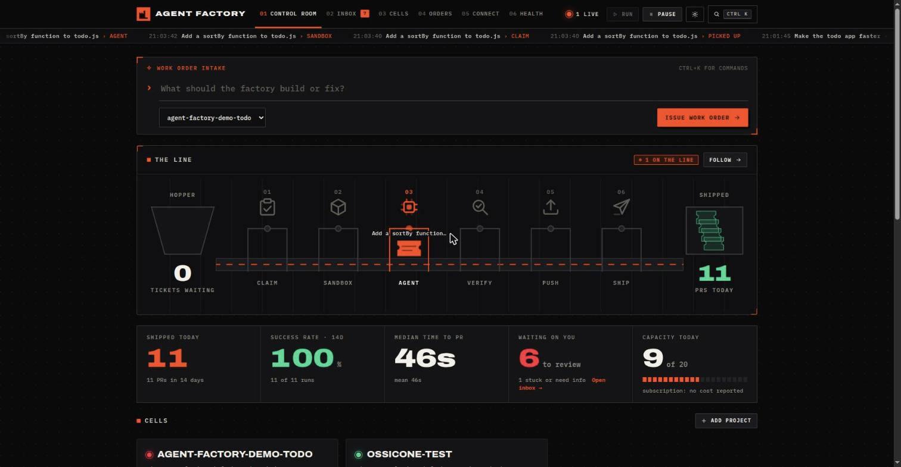

# Agent Factory

**Self-hosted software delivery on autopilot: tickets in, reviewed pull requests out.**

Label a GitHub issue `agent-ready` (or queue one from the web UI). Agent Factory claims it, runs a coding agent in a locked-down Docker sandbox, runs your tests, and opens a **draft pull request**. If CI fails or you leave review comments, it goes back and pushes fixes. **It never merges: you do.**

- **Bring your own agent**: Claude Code or Codex, on a subscription or an API key. Others can be added behind a small adapter.
- **Runs on your machine**: no hosted service, no telemetry.
- **Prompt it, or click it**: a mission-control web UI *and* an MCP server, so you can say "create a project that…" or "fix the login bug" from Claude and watch it happen.
- **Safe by default**: agents run in containers with no route to the internet except an allowlisted proxy, tickets from strangers are ignored, CI/config files are protected, and daily caps stop runaway use.

> **Status: v0.1, early.** It works end to end on real repositories (see [What's verified](#whats-verified)), but it is young software that runs code written by an AI. Read [Security](#security-model) before pointing it at anything you care about, and start with a throwaway repo.

## Quickstart

You need: **Node 22+**, **Docker** and **git**, plus a Codex (ChatGPT) or Claude login. The GitHub CLI (`gh auth login`) is only needed if you use GitHub; GitLab, Bitbucket and other hosts use a token you paste into the UI.

```bash
git clone https://github.com/stevenmcsorley/agent-factory.git
cd agent-factory
npm install       # one small optional dependency (QuickJS) for MCP Code Mode
npm run init     # checks prerequisites, builds the sandbox image, logs the agent in, adds your first repo
npm start        # prints the UI link
```

Open the printed link (it contains your UI token). Then either label an issue `agent-ready` in your repo or use **Projects → New ticket** in the UI.

`npm run doctor` re-checks everything and tells you how to fix what is wrong.

## How it works

```
 ticket (GitHub issue / Ossicone)         ┌──────────────── Docker sandbox ────────────────┐
   labelled agent-ready  ───►  gate  ───► │  clone → agent edits → tests run               │
   (author must be allowlisted)  │        │  (no internet except the allowlisted proxy)    │
                                 ▼        └───────────────────────┬────────────────────────┘
                  too vague? ask a question                       ▼
                                                       protected-path check → push branch
                                                                  ▼
                     CI fails / review comments  ◄───────  draft pull request  ───►  you review & merge
                              │
                              └──► agent pushes a fix (bounded rounds), then hands back to a human
```

1. **Clarity gate.** A ticket with nothing concrete to build ("make it better") gets a question and the `agent-needs-info` label instead of burning an agent run.
2. **Sandboxed run.** A fresh clone is mounted into a container. The agent can only reach its provider's API through an allowlisting proxy. It gets no GitHub credentials; pushing happens on the host afterwards.
3. **Verify.** Your test command runs in the same sandbox, with a retry if it fails. The command comes from `.agent-factory.json` in the repo, or is auto-detected (npm, pytest, go, cargo, make).
4. **Protected paths.** If the agent touched `.github/`, `.agent-factory.json` or other CI files, the run is rejected and nothing is pushed.
5. **Draft PR**, with the ticket relabelled `agent-review` and a comment linking it.
6. **Feedback loop.** Failing CI or comments from allowlisted users trigger follow-up commits on the same branch, up to a round limit, then `agent-needs-human`.

Ticket states are plain labels: `agent-ready` → `agent-working` → `agent-review` (or `agent-failed`, `agent-needs-info`, `agent-needs-human`).

## The web UI




| Page | What you get |
|---|---|
| **Overview** | A prompt bar ("tell the factory what to do") with a live clarity check; KPI rings (runs today vs cap, success rate, time to PR, what is waiting on you); a **live pipeline** for every run in flight (claim → sandbox → agent → verify → push → PR) with a ticking timer; a 14-day activity chart; project cards with sparklines and queue chips; an activity feed |
| **Project** | A **ticket board** (Queued / Working / In review / Needs attention), open agent PRs, run history, live log, and a new-ticket form |
| **Run** | The full story of one run: timed phases, files changed, tokens, what the agent said, and the verification output |
| **Connect AI** | Copy-paste setup for Claude and other MCP clients, plus the measured token cost of each mode |
| **Health** | The same checks as `npm run doctor`, each with a fix |

Press **Ctrl/⌘ K** anywhere for a command palette (jump to a project, pause, run now, add a project).

It listens on `127.0.0.1` only and every API call needs the token in `state/ui-token`.

## Bring your own tools

Two independent choices per project, mixable freely (for example Jira tickets with a Bitbucket repo):

| **Where the code lives** | How it connects | Pull requests | CI + review feedback loop |
|---|---|---|---|
| **GitHub** | the `gh` CLI you are signed into | draft PR | CI logs + comments |
| **GitLab** (gitlab.com or self-managed) | access token | merge request (`Draft:`) | pipeline job logs + notes |
| **Bitbucket** Cloud | username + app password | pull request (`[Draft]`) | CI status + comments (no build logs in the API) |
| **Any git remote** (Gitea, Forgejo, Azure DevOps, a plain server…) | URL template; ssh keys or https token | none: the branch is pushed and you open the PR | none |

| **Where tickets live** | How it connects | Notes |
|---|---|---|
| **GitHub Issues** | the repo itself | label an issue `agent-ready` |
| **Ossicone** | URL + API token. Use your existing account, or **sign up on any Ossicone server**: the UI checks whether sign-up is open and links you to register and generate a token | one project can fan out to several repos with a `repo:owner/name` label |
| **Jira** (Cloud or Data Center) | URL + email + API token | state is kept in labels, so no workflow changes; optional status transitions |
| **Linear** | personal API key | state is kept in labels, created automatically |

Add them in the UI (**Add a project** has a guided flow with *Test connection* buttons and project pickers) or let an AI do it through MCP (`list_integrations`, `add_project`). Tokens you paste are checked against the real service **before** anything is saved, and stored only in an owner-only file (`state/secrets.env`), never in the config; each project can read only `AF_*` secrets, never arbitrary environment variables. Only tickets created by *you* (your Jira account, Linear user, Ossicone user, GitHub login) can queue work.

Adding another tracker or host is a small adapter plus one registry entry (`src/sources.mjs`, `src/hosts.mjs`); it then appears in the UI, validation and MCP automatically.

## Drive it by prompt (MCP)

The factory is also an MCP server, so an AI can run it for you: *"create a project that does X"*, *"what is the factory doing?"*, *"queue a fix for the login bug and tell me when the PR is up"*.

```bash
# Claude Code (the UI's Connect page shows this with your token filled in)
claude mcp add --transport http agent-factory http://127.0.0.1:7777/mcp-code --header "Authorization: Bearer <your-token>"
```

| Endpoint | Tools | Context cost per session |
|---|---|---|
| `/mcp-code` (recommended) | `search` + `execute`: the AI writes a few lines of JavaScript that run in a free in-process **QuickJS sandbox** (no network or filesystem) and calls `factory.*` | ~270 tokens |
| `/mcp` | 16 direct tools (`create_ticket`, `create_project`, `get_run`, `activity`, `metrics`, …) | ~1,700 tokens |

Vague requests are refused with advice (`create_ticket` runs the clarity check), and the factory still never merges. Code Mode needs the optional `quickjs-emscripten` dependency (installed by `npm install`). Bearer-token auth only for now: ChatGPT connectors need a public HTTPS URL plus OAuth, which this local server does not provide.

## Configuration

`npm run init` writes `agent-factory.json`; you rarely need to edit it. Projects can be added from the UI or the CLI (`node src/cli.mjs add owner/repo`).

```jsonc
{
  "agent":   { "kind": "codexContainer", "codexHome": "~/.agent-factory/codex" },   // or "claudeContainer"
  "limits":  { "maxRunsPerDay": 20, "dailyBudgetUsd": 5, "maxAttempts": 2, "timeoutMs": 900000 },
  "projects": [
    { "id": "my-app", "repo": "me/my-app", "base": "main",
      "tickets": { "kind": "github", "allowedAuthors": ["me"] } }
  ]
}
```

**Per-repo settings** live in the repo itself, in `.agent-factory.json` on the base branch (so an agent cannot rewrite its own rules):

```json
{ "verify": "npm ci && npm test", "image": "node:22-bookworm", "maxAttempts": 3, "protectedPaths": [".github/", "infra/"] }
```

Project config selects a ticket `source` and a code `host` (see [Bring your own tools](#bring-your-own-tools)). One Ossicone project can fan out to several repos with a `repo:owner/name` label and an `allowedRepos` list.

## Security model

Agent Factory runs code that a language model wrote, driven by text anyone with access to your tracker can type. Treat it like a CI system, not a toy.

- **Who can queue work:** only issues authored by `allowedAuthors` (GitHub) / `allowedReporterIds` (Ossicone). Ticket text is treated as untrusted data in the agent's prompt.
- **Sandbox:** each run is a throwaway container (`--user` = your uid, 2 GB / 2 CPU) on a Docker `--internal` network. The only way out is a tiny proxy that allows CONNECT to your agent's API hosts (and the npm registry) and denies everything else. The agent receives no GitHub token.
- **Credentials:** Codex uses a **dedicated login directory** for the factory, never your personal `~/.codex` (a container refreshing tokens could invalidate your own session). Claude uses a long-lived token from `claude setup-token` or an API key, passed by name (`docker -e KEY`), never on a command line or in logs. Secrets live in `state/secrets.env` (mode 600), not in the config.
- **Blast radius:** PRs only, never merges; protected paths (CI, its own config) are off limits; caps on runs per day, attempts, time and (for API keys) spend; `Pause` in the UI or `touch state/STOP` halts everything.
- **UI/API:** loopback bind (refused otherwise unless you opt in), bearer token on every API route, Host-header allowlist against DNS rebinding, same-origin writes only, strict CSP, request size limits, no `innerHTML`.
- **Known limits:** the proxy allows any path on an allowed host (so a sandboxed agent could still send data *to* `api.anthropic.com`/`chatgpt.com`); a determined prompt injection in a ticket from an allowed author is still a risk, so review every PR; Docker is not a perfect security boundary; if you expose the UI beyond localhost, put TLS and your own auth in front.

Report vulnerabilities privately via GitHub's "Report a vulnerability" (Security tab), not a public issue. See [SECURITY.md](SECURITY.md).

## Provider terms

Using a consumer subscription (ChatGPT, Claude) to drive an unattended agent may be restricted by the provider's terms, and OpenAI's own guidance recommends API keys for CI-style automation. Read the current terms for whichever you use. Subscription runs also share rate limits with your normal use, which is why `maxRunsPerDay` exists.

## What's verified

All of this was run for real, not just unit-tested:

- Issue → sandboxed agent (Claude and Codex) → tests → draft PR on real GitHub repos, including across multiple repos from one tracker.
- Failing GitHub Actions CI → log fetched → agent fix pushed → CI green. Review comment → follow-up commit.
- Crash recovery, daily caps, protected paths, repo allowlist, clarity gate.
- The egress proxy blocking direct access and non-allowlisted hosts (real Docker test).
- The web UI used in a real browser: a ticket typed into the prompt bar became a PR while the live pipeline view tracked it; run detail, board, charts and Connect pages checked against real runs.
- Creating a brand-new GitHub repo from a template, building it from a one-paragraph spec, answering a review comment on it, and bouncing a vague ticket; all against real GitHub and re-verified independently (clone, run its tests).
- The MCP server driven by the official MCP SDK client against the running app (handshake, tools, Code Mode execute, error handling).

**Integrations, honestly:** GitHub (both roles) and Ossicone (identify, sign-up probe, listing 24 real projects) were run against the real services. Jira, Linear, GitLab and Bitbucket were built from their API documentation and tested against fakes that mirror those APIs, plus real calls confirming the endpoints are reached and bad credentials fail cleanly (GitLab and Linear 401, Jira site-unavailable; Bitbucket returned an inconclusive 503 for a made-up workspace). **I have not run a full ticket → PR cycle on a real Jira, Linear, GitLab or Bitbucket account**; please try one and open an issue if anything differs from the docs.

**Not done yet:** a long unattended soak (days), non-Node repos end to end (detection exists; images/egress hosts are yours to set), GitLab/other forges, webhooks instead of polling, SQLite state (it is JSON files), multi-user auth for the UI.

## Development

```bash
npm test                          # ~72 tests, no network needed
FACTORY_DOCKER_TESTS=1 npm test   # also runs the real Docker egress-proxy test
```

One optional dependency (QuickJS, for MCP Code Mode); everything else is plain Node. Layout: `src/factory.mjs` (ticket loop), `src/feedback.mjs` (CI/review loop), `src/engine.mjs` (projects, limits), `src/server.mjs` + `ui/` (API, UI and MCP), `src/ops.mjs` (every operation, defined once and served as REST, MCP tools and Code Mode), `src/adapters/` (tickets, sandbox, agents, git host). Design notes: [docs/design.md](docs/design.md); the landscape and why this exists: [docs/landscape.md](docs/landscape.md).

## License

Apache-2.0. See [LICENSE](LICENSE).
