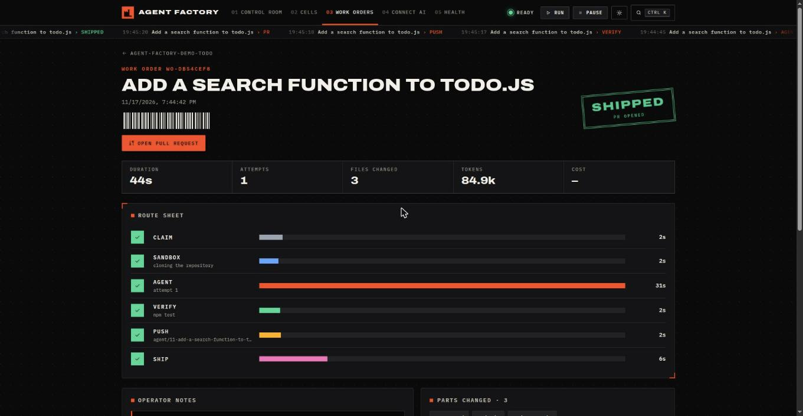

# Agent Factory

<p align="center"></p>

**Self-hosted software delivery on autopilot: tickets in, reviewed pull requests out.**

🤖 **Driving it with Claude or Codex?** Hand your agent [docs/AGENT-GUIDE.md](docs/AGENT-GUIDE.md) (or run `agent-factory agents-md`).

🛡️ **Evaluating the AI workflow?** Read [docs/WORKFLOW.md](docs/WORKFLOW.md) (stages, trust boundaries, guardrails, failure modes, open risks) run `npm run drill` to watch each guardrail hold against a scripted misbehaving agent, and `npm run drill:real` to see a real model on adversarial tickets.

🧭 **Known gaps and what is next:** [docs/gaps-and-roadmap.md](docs/gaps-and-roadmap.md) (what a real 17-ticket run exposed, what is built and what is not).

📖 **New here? Read the [illustrated guide](docs/GUIDE.md)**: install in five minutes, a tour of every screen, connecting your tools, safety, and an honest production-readiness checklist.

Label a GitHub issue `agent-ready` (or queue one from the web UI). Agent Factory claims it, runs a coding agent in a locked-down Docker sandbox, runs your tests, and opens a **draft pull request**. If CI fails or you leave review comments, it goes back and pushes fixes. **It never merges: you do.**

It can also run **entirely on your machine**: a built-in issue tracker and a local git repository with its own pull requests, so you can go from an idea to reviewed, merged code with no account anywhere, then publish to GitHub (or any git remote) when you decide it is worth sharing. See [Local-first](#local-first-no-accounts-needed).

- **Bring your own agent**: Claude Code or Codex, on a subscription or an API key. Others can be added behind a small adapter.
- **Runs on your machine**: no hosted service, no telemetry.
- **Prompt it, or click it**: a mission-control web UI *and* an MCP server, so you can say "create a project that…" or "fix the login bug" from Claude and watch it happen.
- **Safe by default**: agents run in containers with no route to the internet except an allowlisted proxy, tickets from strangers are ignored, CI/config files are protected, and daily caps stop runaway use.

> **Status: early, and used by one person so far.** It works end to end on real repositories (see [What's verified](#whats-verified), which also lists what is *not*), but it is young software that runs code written by an AI. Read [Security](#security-model) before pointing it at anything you care about, and start with a throwaway repo.

## Look around first (no Docker, no accounts, no agent)

```bash
git clone https://github.com/stevenmcsorley/agent-factory.git && cd agent-factory
npm install
npm run demo      # opens a populated factory in a throwaway folder; Ctrl-C deletes it
npm run drill     # watches nine guardrails hold against a misbehaving scripted agent
```

`npm run demo` builds two sample projects with real git branches and pull requests, a plan launched into tickets, the real code analysis, and sample run history. Open the PRs, read a diff, merge the one that is ready, and see the one that is **blocked because its branch changed after it was checked**. Only the agent runs and their history are pre-recorded; the header says so, and nothing will run. Needs only Node 22 and git (tested on a clean machine).

## Quickstart

You need: **Node 22+**, **Docker** and **git**, plus a Codex (ChatGPT) or Claude login (the demo and the drill need only Node and git). The GitHub CLI (`gh auth login`) is only needed if you use GitHub; GitLab, Bitbucket and other hosts use a token you paste into the UI.

```bash
git clone https://github.com/stevenmcsorley/agent-factory.git
cd agent-factory
npm install       # one small optional dependency (QuickJS) for MCP Code Mode
npm run init     # checks prerequisites, builds the sandbox image, logs the agent in, adds your first repo
npm start        # prints the UI link
```

Open the printed link (it contains your UI token). Then either label an issue `agent-ready` in your repo or use **Projects → New ticket** in the UI.

`npm run doctor` re-checks everything and tells you how to fix what is wrong. Full walkthrough (per-OS prerequisites, creating each token, running it as a service, troubleshooting): **[docs/setup.md](docs/setup.md)**. No clone needed either: `mkdir my-factory && cd my-factory && npx github:stevenmcsorley/agent-factory init`.

## Local-first (no accounts needed)

You do not need GitHub, a tracker or a token to run the whole loop (you do still need Docker and a logged-in agent: `npm run init` sets those up; without them, use `npm run demo` above):

```bash
npm start                                 # open the printed link
# Studio → New project → "On this machine", describe what to build, add a test command (e.g. npm test)
```

* **Built-in tracker** (`tickets.kind: "local"`): issues, epics, comments and states kept in `state/projects/<id>/tracker.json`. Plans create real epics there, an epic closes itself when its last ticket does, and webhooks, scenarios and the inbox work as they do with any tracker.
* **Local forge** (`host.kind: "local"`): a bare git repository per project (`state/forge/<id>/repo.git`) with pull-request records. The agent builds into it exactly as it would on GitHub. You review the **diff**, comment, and press **Merge** (a fast-forward when possible, otherwise a clean merge commit; conflicts are refused and nothing changes). Merging is a human-only action: it is not an agent tool, and no scenario does it by itself.
* **Publish when ready:** set a *publish target* (GitHub, GitLab, Bitbucket or any git remote) and push the base branch. It never force-pushes, refuses if the remote has commits you do not have, and is a deliberate step (a button, `agent-factory publish <project>`, or a `publish` scenario step that must come after a human approval). You can then switch the project to the real repository.
* Or mix: local tracker with a GitHub repo, GitHub Issues with a local repo, whichever suits the project.

CLI: `agent-factory add my-app --host=local --tracker=local` (add `--import=/path/or/url` to start from an existing repository), `agent-factory merge <project> <pr>`, `agent-factory publish <project>`.

**Limits, stated plainly:** it is not a hosting server (nobody else can clone from it until you publish), it has no CI of its own (verification is your test command in the sandbox), and review is diff, comments, merge: no inline comments, approvals or branch rules. A new empty repository has nothing to auto-detect, so give the project a test command when you create it or PRs will say they were not machine-checked.

## How it works

```
 ticket (GitHub issue / Ossicone)         ┌──────────────── Docker sandbox ────────────────┐
   labelled agent-ready  ───►  gate  ───► │  clone → agent edits → tests run               │
   (author must be allowlisted)  │        │  (no internet except the allowlisted proxy)    │
                                 ▼        └───────────────────────┬────────────────────────┘
                  too vague? ask a question                       ▼
                                                       protected-path check → push branch
                                                                  ▼
                     CI fails / review comments  ◄───────  draft pull request  ───►  you review & merge
                              │
                              └──► agent pushes a fix (bounded rounds), then hands back to a human
```

1. **Clarity gate.** A ticket with nothing concrete to build ("make it better") gets a question and the `agent-needs-info` label instead of burning an agent run.
2. **Sandboxed run.** A fresh clone is mounted into a container. The agent can only reach its provider's API through an allowlisting proxy. It gets no GitHub credentials; pushing happens on the host afterwards.
3. **Verify.** Your test command runs in the same sandbox, with a retry if it fails. The command comes from `.agent-factory.json` in the repo, or is auto-detected (npm, pytest, go, cargo, make).
4. **Protected paths.** If the agent touched `.github/`, `.agent-factory.json` or other CI files, the run is rejected and nothing is pushed.
5. **Draft PR**, with the ticket relabelled `agent-review` and a comment linking it.
6. **Feedback loop.** Failing CI or comments from allowlisted users trigger follow-up commits on the same branch, up to a round limit, then `agent-needs-human`.

Ticket states are plain labels: `agent-ready` → `agent-working` → `agent-review` (or `agent-failed`, `agent-needs-info`, `agent-needs-human`).

## The web UI




| Page | What you get |
|---|---|
| **Control room** | **Work-order intake** (describe what you want; a live clarity check tells you if it is specific enough), and **the line**: an animated assembly line where queued tickets wait in the *hopper*, each job rides the belt through six stations (claim → sandbox → agent → verify → push → ship) and finished PRs drop into the *shipped* chute. Every station has its own monoline icon that animates only while that station is working: a check drawing itself, a crate lid lifting, a chip pulsing, a magnifier scanning, an arrow rising, a paper plane taking off. Below it a spec strip (shipped today, success rate, median time to PR, waiting on you, capacity left), your project *cells*, a 14-day output chart, the live line log and recent work orders. A ticker across the top streams events. |
| **Studio** | Start things: a project from a brief (with a prototype-or-deploy target and an optional house style), an existing repo and tracker, a scenario, or a quick ticket |
| **Portfolio** | Every project from brief to shipped on one screen: brief completeness, plan progress, queue, quality, library use, and the **next step** for each, plus a "Needs you" list |
| **Inbox** | Everything waiting on a human, with the reason. **Needs your decision**: tickets the factory bounced for detail or gave up on, showing what it said, the ticket text and the failing run; add the missing detail and **Requeue** (the clarity check re-runs first), comment, open the tracker, or close. **Ready to review**: PRs with a button straight to the PR. **Failing after merge** (GitHub projects): a workflow on the base branch whose latest run failed, with the run's link and the PR it came from; it clears itself when the next run passes (`deployWatch: false` opts a project out). The *Waiting on you* tile and a badge on the nav lead here. |
| **Cells** | One per project, with an andon lamp (green / orange / red), tally counts, and a **ticket board**: Hopper, On the line, In review, Faults. A project page has tabs for the board, the **Tracker** (epics with progress, ticket pages with comments; built-in tracker), plan, brief, **pull requests** (on the local forge: diff, comment, merge, close, publish), work orders, code health and log |
| **Scenarios** | Your workflows with approval gates, their runs (dry run first), and the plugins that add steps |
| **Library** | The reuse library: searchable parts with API, usage, source, tests and who uses them; **repeated code** found across projects with a one-click promote (as a PR); upgrades when a part changes |
| **Work orders** | Every run as a work-order traveler: barcode, a stamped verdict (SHIPPED / REJECTED / HELD), a route sheet with a bar for each station's time, the agent's notes, files changed, and the verification output |
| **Connect AI** | Copy-paste setup for Claude and other MCP clients, with the measured token cost of each mode |
| **Health** | The same checks as `npm run doctor`, each with a fix |

Dark and light themes (toggle in the header). Self-hosted fonts (Archivo, IBM Plex Mono; SIL OFL), so it works offline.

Press **Ctrl/⌘ K** anywhere for a command palette (jump to a project, pause, run now, add a project).

It listens on `127.0.0.1` only and every API call needs the token in `state/ui-token`.

## Briefs, plans and a reuse library

* **Project Pack**: each project has a *Brief* (goal, users, scope, out of scope, done criteria, constraints, conventions, decisions) plus source material (PRDs, research, designs as files, links or text). The agent turns it into a **plan** of epics and small tickets you approve; tickets are released as their dependencies merge. Every run receives the relevant context.
* **Reuse library**: a git repo of tested parts shared by all projects (the first real parts came from the factory finding the same MCP protocol, auth and file-writing code hand-copied across the author's projects, where the copies had already drifted), including themes, UX patterns, forms and skills, grouped into **house styles** a project starts from. The factory finds repeated code across projects at the level of functions, classes, React components and API routes, ranked by what they do (calling an API, auth, caching, retry, streaming, hooks…), plus classes that share an interface but not code (adapters), promotes it as a PR, tells each build "you already have these", records reuse (`.factory/parts.lock.json`), flags rewrites of existing parts, and opens upgrade tickets when a part changes.
* **Lifecycle**: each project aims at *prototype* or *deploy*; the Portfolio shows how many go-live checks pass; going live is a scenario with a human approval. Launching a plan also creates its **epics in Ossicone or Jira**. Several projects can build **in parallel lanes** (`limits.parallelProjects`).
* **Honest verification**: the factory runs the checks itself, flags an agent that weakens, deletes or skips existing tests, refuses results from a run that lost its claim, can cap how many PRs wait for review (`maxOpenReviews`), and each PR names the brief revision and commit it was verified against.
* **Agent-native**: `agent-factory portfolio | brief | source | plan | library … | op <name>` drive a running factory from any terminal or AI agent (same operations as MCP). Give your agent `docs/AGENT-GUIDE.md`.

See the [illustrated guide](docs/GUIDE.md) for the walkthrough.

## Autopilot
Schedules, agent roles (a reviewer), editable skills, designs you approve, and an opt-in autonomous mode that merges and fixes on its own: see [docs/AUTOPILOT.md](docs/AUTOPILOT.md). All of it is controllable over MCP.

## Make it yours

Everything is meant to be adapted: **scenarios** (JSON workflows with human approval gates: prototype only, ship to production, deploy to Cloudflare, your own), **plugins** (new deploy targets, trackers, hosts, rules, part kinds, operations; hash-pinned and enabled by you), **prompts** (a Markdown file replaces the agents' rules) and configuration. The factory can also manage its own repository, with its security core protected from self-edits. See [docs/EXTENDING.md](docs/EXTENDING.md).

## Bring your own tools

Two independent choices per project, mixable freely (for example Jira tickets with a Bitbucket repo):

| **Where the code lives** | How it connects | Pull requests | CI + review feedback loop |
|---|---|---|---|
| **GitHub** | the `gh` CLI you are signed into | draft PR | CI logs + comments |
| **GitLab** (gitlab.com or self-managed) | access token | merge request (`Draft:`) | pipeline job logs + notes |
| **Bitbucket** Cloud | username + app password | pull request (`[Draft]`) | CI status + comments (no build logs in the API) |
| **Any git remote** (Gitea, Forgejo, Azure DevOps, a plain server…) | URL template; ssh keys or https token | none: the branch is pushed and you open the PR | none |
| **On this machine** (local forge) | nothing | draft PR record you review and merge in the UI | your verify command; no CI service |

| **Where tickets live** | How it connects | Notes |
|---|---|---|
| **Built-in tracker** | nothing | no account or token; epics, comments, states inside the factory |
| **GitHub Issues** | the repo itself | label an issue `agent-ready` |
| **Ossicone** | URL + API token. Use your existing account, or **sign up on any Ossicone server**: the UI checks whether sign-up is open and links you to register and generate a token | one project can fan out to several repos with a `repo:owner/name` label |
| **Jira** (Cloud or Data Center) | URL + email + API token | state is kept in labels, so no workflow changes; optional status transitions |
| **Linear** | personal API key | state is kept in labels, created automatically |

Add them in the UI (**Add a project** has a guided flow with *Test connection* buttons and project pickers) or let an AI do it through MCP (`list_integrations`, `add_project`). Tokens you paste are checked against the real service **before** anything is saved, and stored only in an owner-only file (`state/secrets.env`), never in the config; each project can read only `AF_*` secrets, never arbitrary environment variables. Only tickets created by *you* (your Jira account, Linear user, Ossicone user, GitHub login) can queue work.

Adding another tracker or host is a small adapter plus one registry entry (`src/sources.mjs`, `src/hosts.mjs`); it then appears in the UI, validation and MCP automatically.

## Drive it by prompt (MCP)

The factory is also an MCP server, so an AI can run it for you: *"create a project that does X"*, *"what is the factory doing?"*, *"queue a fix for the login bug and tell me when the PR is up"*.

```bash
# Claude Code (the UI's Connect page shows this with your token filled in)
claude mcp add --transport http agent-factory http://127.0.0.1:7777/mcp-code --header "Authorization: Bearer <your-token>"
```

| Endpoint | Tools | Context cost per session |
|---|---|---|
| `/mcp-code` (recommended) | `search` + `execute`: the AI writes a few lines of JavaScript that run in a free in-process **QuickJS sandbox** (no network or filesystem) and calls `factory.*` | ~270 tokens |
| `/mcp` | 19 direct tools (`create_ticket`, `inbox`, `requeue_ticket`, `create_project`, `get_run`, `activity`, `metrics`, …) | ~2,000 tokens |

Vague requests are refused with advice (`create_ticket` runs the clarity check), and the factory still never merges. Code Mode needs the optional `quickjs-emscripten` dependency (installed by `npm install`). Bearer-token auth only for now: ChatGPT connectors need a public HTTPS URL plus OAuth, which this local server does not provide.

## Configuration

`npm run init` writes `agent-factory.json`; you rarely need to edit it. Projects can be added from the UI or the CLI (`node src/cli.mjs add owner/repo`).

### Settings page: choose the model, change the guardrails

Open **Settings** in the UI (`#/settings`) to change, without editing the file or restarting:

- **Model and reasoning effort** for the agent. The list comes from the models your Codex login can use (Codex's own cache), and the effort choices change with the model. Leave the model unpinned and Codex picks its own default, which can change when Codex updates; pin one to make runs repeatable. **Check what a run will use** sends one tiny prompt through the same container and login and shows what Codex reports (model, effort, version). Every run record also stores which agent and model it was asked for.
- **Limits:** runs per day, attempts per ticket, time limit per run, projects in parallel, daily budget. Each is range-checked, and each change is saved to the config file and listed under *Recent changes*.

Changes apply from the next run; a run in progress keeps what it started with. The agent type, sandbox, network allowlist and projects are deliberately not editable here (they are security boundaries). Settings can be changed from the UI, over REST (`GET/POST /api/settings`, `POST /api/settings/probe`) and over MCP (`get_settings`, `set_settings`), so the assistant that drives your factory can tune it. Every change is validated, applied from the next run and written to the audit log.

```jsonc
{
  "agent":   { "kind": "codexContainer", "codexHome": "~/.agent-factory/codex", "model": "gpt-6.2-sol", "reasoningEffort": "medium" },   // or "claudeContainer"; model and effort are optional
  "limits":  { "maxRunsPerDay": 20, "dailyBudgetUsd": 5, "maxAttempts": 2, "timeoutMs": 900000 },
  "projects": [
    { "id": "my-app", "repo": "me/my-app", "base": "main",
      "tickets": { "kind": "github", "allowedAuthors": ["me"] } }
  ]
}
```

**Per-repo settings** live in the repo itself, in `.agent-factory.json` on the base branch (so an agent cannot rewrite its own rules):

```json
{ "verify": "npm ci && npm test", "image": "node:22-bookworm", "maxAttempts": 3, "protectedPaths": [".github/", "infra/"] }
```

Project config selects a ticket `source` and a code `host` (see [Bring your own tools](#bring-your-own-tools)). One Ossicone project can fan out to several repos with a `repo:owner/name` label and an `allowedRepos` list.

## Security model

Agent Factory runs code that a language model wrote, driven by text anyone with access to your tracker can type. Treat it like a CI system, not a toy.

- **Who can queue work:** only issues authored by `allowedAuthors` (GitHub) / `allowedReporterIds` (Ossicone). Ticket text is treated as untrusted data in the agent's prompt.
- **Sandbox:** each run is a throwaway container (`--user` = your uid, 2 GB / 2 CPU) on a Docker `--internal` network. The only way out is a tiny proxy that allows CONNECT to your agent's API hosts (and the npm registry) and denies everything else. The agent receives no GitHub token.
- **Credentials:** Codex uses a **dedicated login directory** for the factory, never your personal `~/.codex` (a container refreshing tokens could invalidate your own session). Claude uses a long-lived token from `claude setup-token` or an API key, passed by name (`docker -e KEY`), never on a command line or in logs. Secrets live in `state/secrets.env` (mode 600), not in the config.
- **Blast radius:** PRs only, never merges (on the local forge, merge and publish are human-only: a button, the CLI, or a scenario step behind an approval); protected paths (CI, its own config) are off limits; caps on runs per day, attempts, time and (for API keys) spend; `Pause` in the UI or `touch state/STOP` halts everything.
- **Local forge:** everything pushed into the bare repo is untrusted. It is created with no hooks and configured to ignore them (pushes run `git-receive-pack`, which reads the repo's own config), objects are fsck-checked, sandboxes clone over `file://` so they copy objects rather than hard-link the repo's files, merging never checks code out (it builds the merge as git objects and moves the branch with a compare-and-swap), protected paths are checked again at merge time, and a branch that changed since the factory verified it cannot be merged.
- **UI/API:** loopback bind (refused otherwise unless you opt in), bearer token on every API route, Host-header allowlist against DNS rebinding, same-origin writes only, strict CSP, request size limits, no `innerHTML`.
- **Known limits:** the proxy allows any path on an allowed host (so a sandboxed agent could still send data *to* `api.anthropic.com`/`chatgpt.com`); a determined prompt injection in a ticket from an allowed author is still a risk, so review every PR; Docker is not a perfect security boundary; if you expose the UI beyond localhost, put TLS and your own auth in front.

Report vulnerabilities privately via GitHub's "Report a vulnerability" (Security tab), not a public issue. See [SECURITY.md](SECURITY.md).

## Provider terms

Using a consumer subscription (ChatGPT, Claude) to drive an unattended agent may be restricted by the provider's terms, and OpenAI's own guidance recommends API keys for CI-style automation. Read the current terms for whichever you use. Subscription runs also share rate limits with your normal use, which is why `maxRunsPerDay` exists.

## What's verified

All of this was run for real, not just unit-tested:

- Issue → sandboxed agent (Claude and Codex) → tests → draft PR on real GitHub repos, including across multiple repos from one tracker.
- Failing GitHub Actions CI → log fetched → agent fix pushed → CI green. Review comment → follow-up commit.
- Crash recovery, daily caps, protected paths, repo allowlist, clarity gate.
- The egress proxy blocking direct access and non-allowlisted hosts (real Docker test).
- The web UI used in a real browser: a ticket typed into the prompt bar became a PR while the live pipeline view tracked it; run detail, board, charts and Connect pages checked against real runs.
- Creating a brand-new GitHub repo from a template, building it from a one-paragraph spec, answering a review comment on it, and bouncing a vague ticket; all against real GitHub and re-verified independently (clone, run its tests).
- A brief + PRD turned into a 5-ticket plan by the real agent, launched, and ticket 1 built into a PR with that context.
- The reuse library on a real private GitHub repo: a part promoted, the library CI green, and a real agent run that was told about the part, copied it with its provenance header, and shipped a PR that lists it and carries `.factory/parts.lock.json`.
- The MCP server driven by the official MCP SDK client against the running app (handshake, tools, Code Mode execute, error handling).

**Integrations, honestly:** GitHub (both roles) and **Ossicone** were run end to end against real servers. For Ossicone that means: a new project created on a live instance, connected through the wizard API, tickets queued in Ossicone, claimed and built into PRs on GitHub, with the ticket's status (`code_review`), labels and a PR-link comment written back to Ossicone; a vague ticket bounced to `agent-needs-info`, then fixed from the inbox (detail appended, requeued, built); comment, edit and close from the inbox. Account creation itself is left to the user: the wizard detects whether a server allows sign-up and links to it. Jira, Linear, GitLab and Bitbucket were built from their API documentation and tested against fakes that mirror those APIs, plus real calls confirming the endpoints are reached and bad credentials fail cleanly (GitLab and Linear 401, Jira site-unavailable; Bitbucket returned an inconclusive 503 for a made-up workspace). **I have not run a full ticket → PR cycle on a real Jira, Linear, GitLab or Bitbucket account**; please try one and open an issue if anything differs from the docs.

**Also verified for real (latest work):**

- **Local-first loop with the real Codex agent:** a project created with no GitHub or tracker account; a ticket built by the agent into the local forge (module, tests, `package.json`); the PR reviewed in the real browser with a coloured diff, provenance and quality gate; merged by fast-forward; and the merged code's tests passing on a fresh clone of the repository.
- **Built-in tracker in the real browser:** epics with progress, a ticket page, a comment posted, and the factory writing a real failure back to a ticket as a comment.
- **Discipline checks** (tests weakened or deleted are flagged, a replaced run cannot publish, the review cap, provenance) are covered by tests against real git with a scripted agent; they have **not** yet been observed with a real agent misbehaving.
- Git-level behaviour of the forge (parallel branches, conflicts, protected paths, a tampered branch, planted hooks, publish with a diverged remote) is tested against real git repositories.

- **Library parts adopted by the real agent in three real projects** (`relay`, `reverb`, `channel-watch`): draft PRs that replace hand-copied code with tested library parts. Checked independently by running them: `channel-watch`'s 124 tests pass on the PR branch, `relay`'s tests pass and its `security.py` is identical to the part, and both MCP servers (`relay`, `reverb`) were started and exercised (health, 401, 405, a real tool listing). This also exposed (and fixed) a bug where tests in a sub-folder were never run by the factory, which is why those three runs were not machine-checked by the factory itself.

- **The full loop on a clean machine** (fresh clone, fresh `HOME` with no git config, no `gh` login and no agent login, a real device-code Codex login, a first project on this machine with a test command): the agent built a small library, the factory ran `npm test`, opened a PR on the local forge, merged it, and the merged code passed the ticket's acceptance criteria when checked independently in a container. Running it found and fixed two bugs: the commit failed on a machine with no git identity, and `init` printed "Done" after a failed login.

**Not verified:** publishing to a real GitHub/GitLab account (tested against a local bare remote only); the Jira epics and the Cloudflare plugin against real services; parallel lanes with several real agents at once; non-Linux systems; a long unattended soak (days).

**Not built yet:** inline review comments and multi-person approvals on the local forge; a tracker file lock for multiple processes; SQLite state (it is JSON files); multi-user auth for the UI; metrics for time from ready to merged.

## Development

```bash
npm test                          # ~200 tests, no network needed
FACTORY_DOCKER_TESTS=1 npm test   # also runs the real Docker egress-proxy test
```

One optional dependency (QuickJS, for MCP Code Mode); everything else is plain Node. Layout: `src/factory.mjs` (ticket loop), `src/feedback.mjs` (CI/review loop), `src/engine.mjs` (projects, limits), `src/server.mjs` + `ui/` (API, UI and MCP), `src/ops.mjs` (every operation, defined once and served as REST, MCP tools and Code Mode), `src/adapters/` (tickets incl. the built-in tracker, sandbox, agents, git hosts incl. the local forge `host-local.mjs`), `src/quality.mjs` (quality gate and test-tampering checks), `src/leases.mjs` (claims with fencing tokens), `src/library.mjs`, `src/pack.mjs`, `src/scenarios.mjs`, `src/plugins.mjs`. Design notes: [docs/design.md](docs/design.md), [docs/design-local-forge.md](docs/design-local-forge.md); the landscape and why this exists: [docs/landscape.md](docs/landscape.md).

## License

Apache-2.0. See [LICENSE](LICENSE).
