<div align="center">

# Agent Factory

**Tickets in. Reviewed pull requests out. On your own machine.**

A self-hosted software factory: it claims a ticket, builds it with a coding agent in a locked-down sandbox, checks the work itself, and hands you a reviewed pull request. Mix Codex, free cloud models and local models, and watch every job ride the line.

[](LICENSE)
[](docs/setup.md)
[](#development)
[](#development)
[](#security-model)

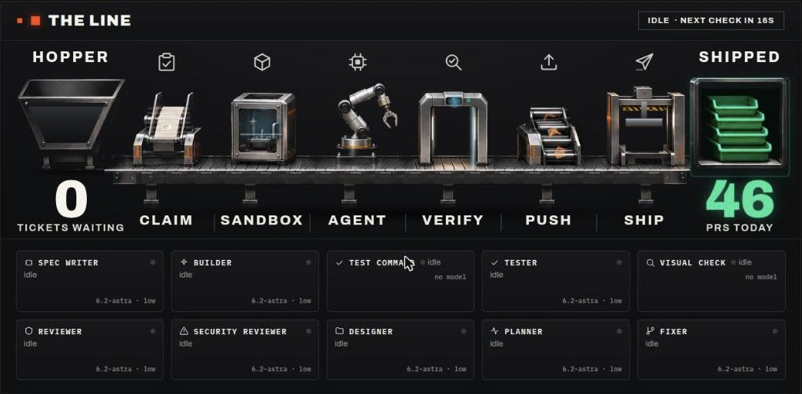

<sub>The Control room. Every job is a parcel: out of the hopper, through six machines, into the bin. Real screenshot, live data.</sub>

</div>

---

> **Status: early, and used by one person so far.** It works end to end on real repositories, and [What's verified](#whats-verified) says plainly what has and has not been proven. Review every pull request it opens.

## What it does

Label a GitHub issue `agent-ready` (or write a ticket in the web UI). Agent Factory then:

1. **Claims** the ticket and asks a question instead of burning a run if it is too vague.
2. **Builds** it with a coding agent inside a Docker sandbox that has no route to the internet except an allowlisted proxy.
3. **Checks** the work itself: your tests, an honesty check on what the agent claims, a code-quality gate, an optional screenshot check, and a second agent that reads the diff.
4. **Opens a draft pull request** (or merges and fixes on its own, if you turn autonomy on).

It can run **entirely on your machine**: a built-in issue tracker and a local git repository with its own pull requests, so you can go from an idea to merged code without an account anywhere.

<table>
<tr>
<td width="50%">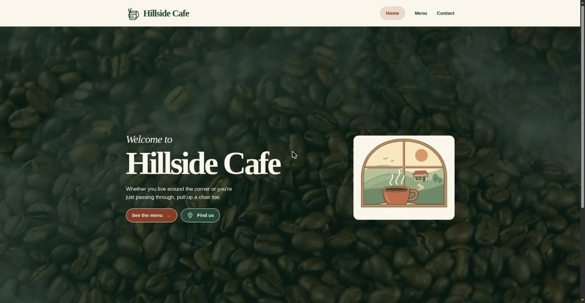</td>
<td width="50%">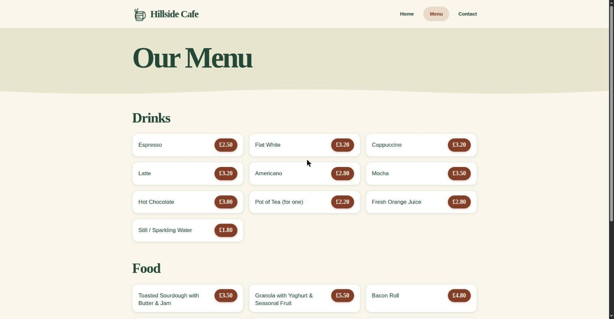</td>
</tr>
<tr>
<td colspan="2" align="center"><sub><b>Built by the factory from a one-paragraph brief:</b> a plan of tickets, designs and artwork made first, then 13 tickets built, reviewed and merged. The hero video is a CC-BY stock clip the factory was told to use; every credit is on the page.</sub></td>
</tr>
</table>

## Why it is different

| | |
|---|---|
| **Sandboxed and local-first** | Each run is a throwaway container on an internal network. No hosted service, no telemetry. Add a project with no GitHub account at all. |
| **Design first, then build** | For a site or app with screens, the designer makes mockups and SVG artwork first; you approve them; the builders follow them. A restyle flow redoes an existing project the same way. |
| **Any model mix** | **Codex**, **free OpenRouter models** and **local models** (Ollama and friends), chosen per agent. Free and local models take the jobs they do well; Codex does the rest and carries on when they cannot. |
| **A harness around every model** | The model is the swappable part. Around it sit checks that do not take its word for anything, and cheaper models start first with a stronger one stepping in when a check fails. |
| **It improves itself, with your say-so** | Every finished job is scored. Problems that keep coming back become suggested fixes you approve, and the page measures whether they helped. |
| **Measured, not assumed** | Usage by model, agent and project; limits and when they reset; benchmarks for the cheaper-model defaults; a panel that answers "is the harness working?". |
| **Autonomous when you say so** | One switch makes a project run unattended: reviewers on, fix rounds, conflict resolution, merging, with caps. |
| **Drive it by prompt** | An MCP server with **144 operations**. In Code Mode the AI needs about **270 tokens** of context, not 21,000. |

## See it work

<table>
<tr>
<td width="50%"><a href="docs/img/agents-harness.jpg">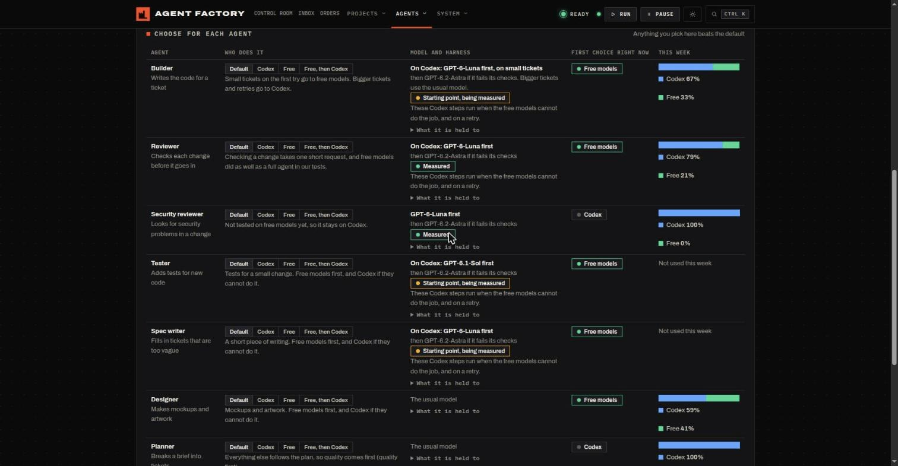</a><br><sub><b>Agents.</b> Who does each job, the model steps it goes through, and the harness it is held to.</sub></td>
<td width="50%"><a href="docs/img/improvements.jpg">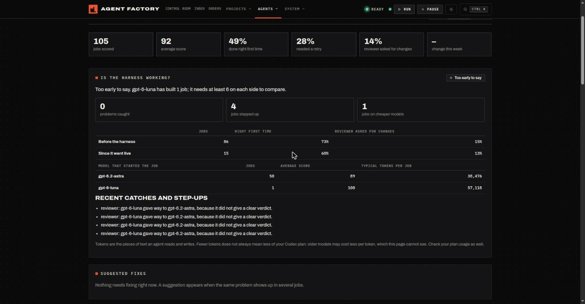</a><br><sub><b>Improvements.</b> Job scores and a plain answer to "is the harness working?". Suggested fixes appear below when a problem keeps coming back.</sub></td>
</tr>
<tr>
<td width="50%"><a href="docs/img/usage.jpg">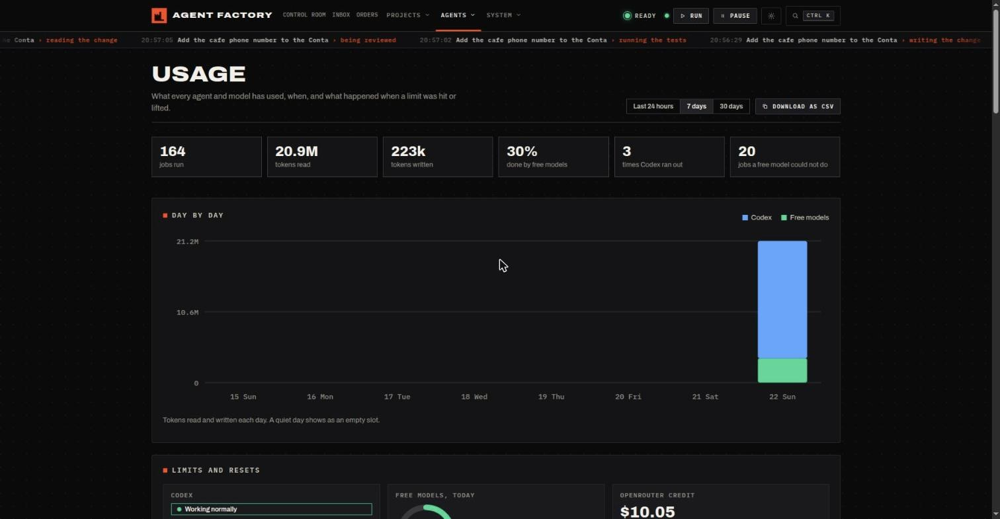</a><br><sub><b>Usage.</b> What every agent and model used, when, and what happened at each limit.</sub></td>
<td width="50%"><a href="docs/img/portfolio.jpg">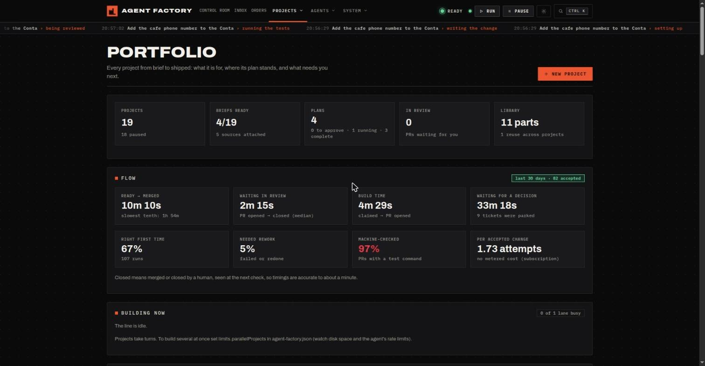</a><br><sub><b>Portfolio.</b> Every project from brief to shipped, with flow metrics.</sub></td>
</tr>
</table>

## Look around first (no Docker, no accounts, no agent)

```bash
git clone https://github.com/stevenmcsorley/agent-factory.git && cd agent-factory
npm install
npm run demo      # a populated factory in a throwaway folder; Ctrl-C deletes it
npm run drill     # watches nine guardrails hold against a misbehaving scripted agent
```

`npm run demo` builds two sample projects with real git branches and pull requests, a plan launched into tickets, the real code analysis, and sample run history.

## Quickstart

You need **Node 22+**, **Docker** and **git**, plus a Codex (ChatGPT) or Claude login. The GitHub CLI (`gh auth login`) is only needed for GitHub projects. Per-OS steps are in [docs/setup.md](docs/setup.md).

```bash
git clone https://github.com/stevenmcsorley/agent-factory.git
cd agent-factory
npm install       # one small optional dependency (QuickJS) for MCP Code Mode
npm run init      # checks prerequisites, builds the sandbox image, logs the agent in, adds your first repo
npm start         # prints the UI link (it contains your UI token)
```

Open the link, then label an issue `agent-ready` or use **Projects → New ticket**. `npm run doctor` re-checks everything and says how to fix what is wrong.

**No GitHub at all?** In the UI choose **Studio → New project → On this machine**, describe what to build, add a test command (for example `npm test`), and go.

## How it works

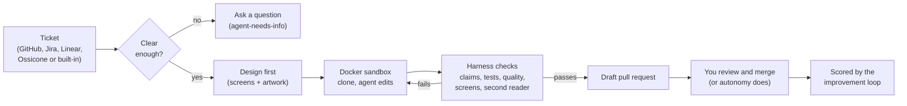

Every stage is one of the machines on the Control room's line: **Claim → Sandbox → Agent → Verify → Push → Ship**, with the review and the screenshot check sitting at Verify.

1. **Clarity gate.** A ticket with nothing concrete to build gets a question and the `agent-needs-info` label.
2. **Sandboxed run.** A fresh clone is mounted into a container. The agent reaches only its provider's API, through an allowlisting proxy, and gets no GitHub credentials; pushing happens on the host afterwards.
3. **The agent sees the whole ticket.** The text, the project brief, the approved designs, and any notes the owner added in the comments (from trusted authors only).
4. **Verify.** Your test command runs in the same sandbox, with a retry on failure. It comes from `.agent-factory.json` in the repo, or is detected (npm, pytest, go, cargo, make).
5. **The harness checks the claims.** A free, deterministic check compares what the agent says with what it did: a test switched off, or "I added tests" with no test file changed, goes back to the builder like a failing test.
6. **Quality gate, screens, second reader.** Secrets and vulnerabilities in the changed lines, weakened tests, a screenshot check at three widths, and a second agent that reads the diff.
7. **Protected paths.** If the agent touched CI files or the factory's own config, the run is rejected and nothing is pushed.
8. **Draft PR**, with the ticket relabelled `agent-review`. Failing CI or reviewer findings trigger bounded fix rounds, then it hands back to a human.

Ticket states are plain labels: `agent-ready` → `agent-working` → `agent-review` (or `agent-failed`, `agent-needs-info`, `agent-needs-human`).

## Who does the work: Codex, free models, local models

Pick the provider per agent, or for everything:

| Mode | What it means |
|---|---|
| **Both** (default) | Free models take what they do well (reviews, short writing, small first attempts). Codex does the rest, and does any job a free model cannot answer. If Codex runs out of plan, the free models carry on. |
| **Codex only** | Everything uses your Codex plan. Work waits if it runs out. |
| **Free models only** | Everything uses free OpenRouter models. |
| **Local only** | Everything runs on models on your own hardware (Ollama, LM Studio, llama.cpp, vLLM). Off until you switch it on. |

- **Free models** are used at full capacity: a router ranks them, learns how long each rests after a limit, swaps to the next mid-task, and keeps a daily allowance gauge.
- **Local models** are free and private, but a CPU-only laptop is slow. On a 4-core, 12 GB laptop the best small model tried (`qwen2.5:3b`) caught 3 of 8 planted defects, against 7 to 8 for Codex, so they suit short jobs and standing in when everything else is down. Models Ollama runs on its own servers (`:cloud`) are flagged as not local and kept out unless you allow them.

## The harness: reliable results from cheaper models

A coding model is an engine you rent, and it can be wrong, lazy or quietly dishonest. The **harness** is everything the factory puts *around* the model so that the result is dependable whichever model produced it: the checks it must pass, the limits it works under, what happens when it fails, and a record of all of it. The model is the swappable part; the harness is the constant part. That is what makes it safe to start on an older, cheaper model and step up only when needed.

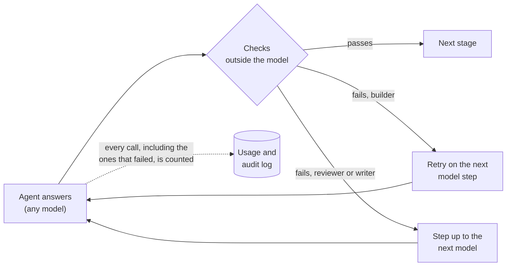

**What each agent is held to** (also shown in the UI under Agents → Who does what → *What it is held to*, so it is never a secret):

| Agent | Checked outside the model | Limits |
|---|---|---|
| **Builder** | the project's tests must pass; its summary must match its diff (no tests claimed but not written, none switched off); the quality gate and the design and screenshot checks; a second agent reads the change | a time limit per attempt, a fixed number of attempts, each on the next model step |
| **Fixer** | tests, the claims check, and the reviewer reads it again | a fixed number of fix rounds |
| **Reviewer** | the answer must be a clear verdict (approve or changes) whose findings name a severity; if not, the next model does the review | one request about the diff, with no repository to wander through |
| **Security reviewer** | a clear verdict, or the next model does it | one request, no tools |
| **Tester** | the new tests must pass, otherwise they are undone; only test files may change | runs once per ticket |
| **Spec writer, skill writer** | it must write something real, not an empty or one-line answer; nothing a skill writer drafts is saved until you approve it | a short piece of writing, no tools |
| **Designer, planner** | you approve designs and plans before anything is built from them | the planner stays on the strongest model |

**Things a prompt alone could not do** (each found by running the factory for real and fixed):

- **The claims check.** A free, deterministic comparison of what the agent *says* with what its diff *shows*: a test switched off (`skip`, `only`, `todo`), or "I added tests" with no test file changed, goes back to the builder like a failing test. No model is involved, so it costs no tokens.
- **A verdict is one request.** A review on Codex used to be an agent exploring the whole repository (about 39,000 tokens each). It is now one request about the diff on an empty folder, the form that was benchmarked: about a seventh of the tokens.
- **Every road into Codex starts on the cheapest step.** After a free model fails, after a retry, on the main path: all of them use the same ladder, so a stronger model is only used when a cheaper one failed its check.
- **Failed calls still count.** When a job steps up, the tokens spent on the call that failed are added to the job, so a step-up never looks cheaper than it was. (The real-path drill found the first version losing them.)
- **The owner's answers reach the agent.** A comment you write on a ticket, from a trusted author, is put in the agent's prompt. Comments from anyone else, and the factory's own, never are. (Before this, answers to the agent's questions were silently ignored.)

### Model steps: cheaper models first

Codex agents start on an **older, cheaper Codex model** and step up to the usual one when a check fails:

| Agent | Starts on | Evidence |
|---|---|---|
| Reviewer | `gpt-6-luna` | **Measured:** 8/8 planted defects, 0 false blocks (`gpt-6-luna`, `gpt-5.6-luna`, `gpt-6.1-sol`), against 7/8 for the usual model |
| Security reviewer | `gpt-6-luna` | **Measured:** 6/6 planted vulnerabilities, 0 false blocks |
| Builder | `gpt-6-luna` on small tickets only | **Provisional:** 6/6 small hidden-test tickets on every model tried; says nothing about big ones |
| Tester, spec writer, skill writer | cheaper models | **Provisional**, labelled as such in the UI |
| Designer, planner, fixer | the usual model | not measured yet |

Override any of it per agent, or switch every default off (`defaultTiers: false`). Every step-up is written to the audit log with its reason.

### See it working

<a href="docs/img/harness-panel.jpg">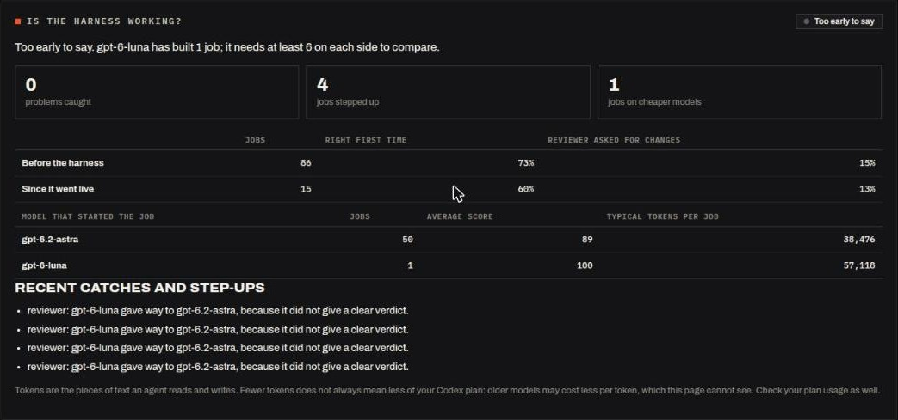</a>

The panel above is on **Agents → Improvements** (and over MCP as `harness_report`). It shows a plain verdict, what the claims check caught, how many jobs were stepped up and why, first-time success before and after the harness, and how the cheaper models compare with the usual one in score and tokens per job. The four step-ups listed are real: on those reviews `gpt-6-luna` did not give a clear verdict, the check refused it, and `gpt-6.2-astra` did the review.

**Honest status.** The verdict reads **"too early to say"**, and that is the truth: the cheaper builder has run on only one real job, and the claims check has not yet caught anything in real use. The benchmarks show the cheaper models can do these jobs; they do not show how much of your Codex plan they save, because token counts cannot see plan usage (an older model may cost less per token). Watch your own plan usage, and let the panel tell you when it has enough jobs to judge.

Re-run the evidence yourself:

```bash
node scripts/review-bench.mjs --codex-model=gpt-6-luna --effort=low --strategies=shot_rules
node scripts/role-bench.mjs --role=security --models=gpt-6-luna,gpt-6.2-astra
node scripts/role-bench.mjs --role=builder  --models=gpt-6-luna,gpt-6.2-astra
node scripts/harness-drill.mjs      # proves the step-up on the real Codex path
```

## Design first, then build

For a project with pages, **design is stage zero**. Before any build ticket is released, the **designer** (an agent like the others, with its own harness) makes the look of the project and you approve it. Builders then follow what was approved, not their own taste.

<table>
<tr>
<td width="33%"><a href="docs/img/design-mockup.jpg">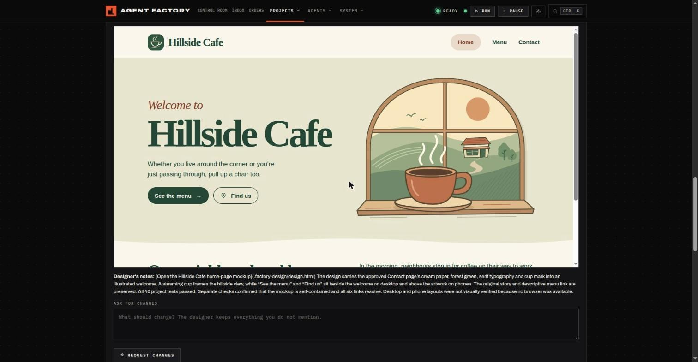</a></td>
<td width="33%"><a href="docs/img/design-artwork.jpg">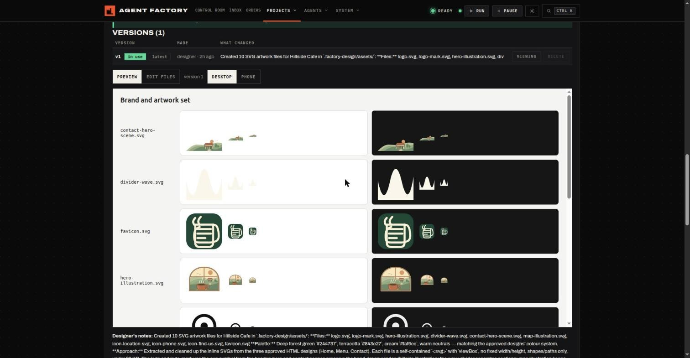</a></td>
<td width="33%"><a href="docs/img/design-stage.jpg">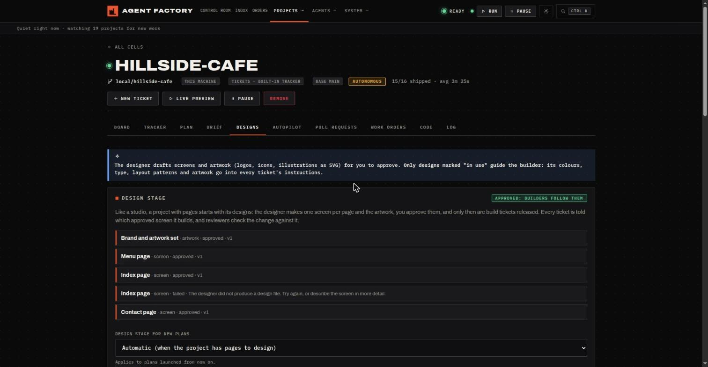</a></td>
</tr>
<tr>
<td><sub><b>A screen.</b> A finished full-page mockup, at desktop and phone width, with the designer's notes and an <i>Ask for changes</i> box that sends your comment back to the designer.</sub></td>
<td><sub><b>The artwork.</b> The logo, hero, divider, map and icons, drawn as SVG code and shown on light and dark at three sizes, so a bad one is obvious.</sub></td>
<td><sub><b>The design stage.</b> Every design and its status. Only approved ones are <i>in use</i>. (The failed Index design is real: the first try failed, the designer was run again, and the retry worked.)</sub></td>
</tr>
</table>

**How a design becomes a build**

1. **The designer drafts.** From the brief and sources it makes one screen per page named in the brief (up to five) and one artwork set. Artwork is code (SVG, no scripts, no external references), so it is small, crisp and reviewable in a diff. Each design takes a few minutes and runs in the background.
2. **You review.** Preview each design at desktop and phone width, edit its files, ask for changes (the designer keeps everything you do not mention), or approve it. In [unattended mode](docs/AUTOPILOT.md) the designs approve themselves.
3. **Approved means in use.** Only approved designs guide the builder: their colours, type, layout patterns and artwork are written into every ticket's instructions, and the reviewer checks each change against them. Build tickets are not released until the designs exist.
4. **Drift is flagged.** Each page records which design version it was built from. If you approve a newer design, the page is shown as behind it.
5. **If one design fails,** the rest still run. Each design gets a second try, and the pass reports exactly which one is missing so you can run it again.

**Restyle an existing project.** Give a direction in a few sentences ("warm, characterful, forest green and terracotta, a hero illustration of a steaming cup"). The designer looks at what exists, designs the new look for the key pages (or all of them) plus new artwork if the direction mentions a brand or illustrations, and after you approve, the factory plans the match: a **shared look first, then the artwork, then one ticket per page**. That is how the Hillside Café above went from a plain page to the designed one, with every change reviewed and tested.

**Honest limits.** The designer is not benchmarked (unlike the reviewer), and by default it runs on the usual model with the free models first where they can do the job. Its work is judged by you, and by the screenshot check when you have it set up. It makes clean, stylised, drawn-as-code artwork, not photographs: if you want a photo or a video, give the factory the file and it will place and optimise it (the café's looping hero video was added exactly this way, with the licence credit on the page).

## It improves itself, with your approval

- **Scores.** Every finished job is scored from what was recorded: retries, its own tests, what the reviewer found, the screenshot and quality checks. Retries are explained by their real cause.
- **Suggested fixes.** A problem that appears in enough jobs becomes a concrete suggestion: an instruction the agents will be given (a *skill*), or a change of who builds. Each shows its evidence. You can edit the wording, apply it, or say not now.
- **Did it help?** After a fix is applied the same problem is measured again on the jobs that follow.
- **Which model builds better?** Jobs are scored by the model that started them, and a cheaper model is only suggested once it has earned it over enough jobs.

## The web UI

| Where | What you get |
|---|---|
| **Control room** | The live **Line**, the agent bench (every agent, what it is doing and on which model), flow metrics, and a quick ticket form. Updates are pushed to the page, so it does not poll. |
| **Inbox** | Everything waiting on a human, with the reason: pull requests to review (a GitHub-style diff viewer; merge, reject, rebuild, resolve conflicts), tickets that need detail, plans waiting. |
| **Orders** | Every run as a work order: a stamped verdict, the route through each station with timings, the agent's notes, the files changed and the checks. |
| **Projects ▾** | **Portfolio** (every project from brief to shipped, with flow metrics and the next step for each) · **Studio** (start a project from a brief, an existing repo, a scenario or a quick ticket) · **Library** (the reuse library) · **Scenarios** (workflows with approval gates). |
| **Agents ▾** | **Agents and models** (who does what, the harness, free models, local models, Codex settings) · **Usage** (tokens by model, agent and project; limits and resets; CSV) · **Improvements** (scores, suggested fixes, is the harness working). |
| **System ▾** | **Connect** (copy-paste setup for Claude and other MCP clients) · **Health** (the same checks as `npm run doctor`) · **Settings** (limits and autonomy). |

A project's own page has tabs: **Board, Tracker, Plan, Brief, Designs, Autopilot, Pull requests, Work orders, Code, Log**.

Dark and light themes, self-hosted fonts (works offline), and **Ctrl/⌘ K** for a command palette. It listens on `127.0.0.1` only and every API call needs the token in `state/ui-token`.

## Autopilot

Schedules, agent roles (reviewer, security reviewer, tester, spec writer, designer), editable skills, designs you approve, and an opt-in **unattended mode** that makes a project run start to finish: roles on, fix rounds on reviewer findings, automatic conflict resolution, merging behind caps. Full details in [docs/AUTOPILOT.md](docs/AUTOPILOT.md); all of it is controllable over MCP.

## Briefs, plans and a reuse library

- **Project Pack.** Each project has a *Brief* (goal, users, scope, out of scope, done criteria, constraints, conventions, decisions) plus source material (PRDs, research, designs, links). The planner turns it into epics and tickets with sizes, and every build is given the relevant slice.
- **Reuse library.** A git repo of tested parts shared by all projects. The factory finds code repeated across projects, promotes it to the library as a PR, and tells future builds what already exists.
- **Lifecycle.** Each project aims at *prototype* or *deploy*; going live is a scenario behind a human approval.
- **Honest verification.** The factory runs the checks itself, flags an agent that weakens, deletes or skips tests, refuses results from a run that lost its claim, and can cap how many PRs wait for review.
- **Agent-native.** `agent-factory portfolio | brief | source | plan | library … | op <name>` drive a running factory from any terminal or AI agent, with the same operations as MCP. Give your agent [docs/AGENT-GUIDE.md](docs/AGENT-GUIDE.md).

## Local-first (no accounts needed)

- **Built-in tracker** (`tickets.kind: "local"`): issues, epics, comments and states kept in `state/projects/<id>/tracker.json`. Plans create real epics there, and an epic closes itself when its last ticket does.
- **Local forge** (`host.kind: "local"`): a bare git repository per project (`state/forge/<id>/repo.git`) with pull-request records. The agent builds into it exactly as it would on GitHub, and you review the diff and merge in the UI.
- **Publish when ready.** Set a publish target (GitHub, GitLab, Bitbucket or any git remote) and push. It never force-pushes, and refuses if the remote has commits you do not have.
- Mix freely: local tracker with a GitHub repo, GitHub Issues with a local repo, whichever suits.

CLI: `agent-factory add my-app --host=local --tracker=local` (add `--import=/path/or/url` to start from an existing repository), `agent-factory merge <project> <pr>`, `agent-factory publish <project>`.

**Limits, stated plainly:** it is not a hosting server (nobody else can clone from it until you publish), it has no CI of its own (verification is your test command in the sandbox), and review is diff and comments only.

## Bring your own tools

Two independent choices per project, mixable freely (for example Jira tickets with a Bitbucket repo):

| **Where the code lives** | How it connects | Pull requests | CI + review feedback loop |
|---|---|---|---|
| **GitHub** | the `gh` CLI you are signed into | draft PR | CI logs + comments |
| **GitLab** (gitlab.com or self-managed) | access token | merge request (`Draft:`) | pipeline job logs + notes |
| **Bitbucket** Cloud | username + app password | pull request (`[Draft]`) | CI status + comments (no build logs in the API) |
| **Any git remote** (Gitea, Forgejo, Azure DevOps, a plain server…) | URL template; ssh keys or https token | none: the branch is pushed and you open the PR | none |
| **On this machine** (local forge) | nothing | draft PR record you review and merge in the UI | your verify command; no CI service |

| **Where tickets live** | How it connects | Notes |
|---|---|---|
| **Built-in tracker** | nothing | no account or token; epics, comments, states inside the factory |
| **GitHub Issues** | the repo itself | label an issue `agent-ready` |
| **Ossicone** | URL + API token (use your account, or sign up on any Ossicone server from the UI) | one project can fan out to several repos with a `repo:owner/name` label |
| **Jira** (Cloud or Data Center) | URL + email + API token | state is kept in labels, so no workflow changes; optional status transitions |
| **Linear** | personal API key | state is kept in labels, created automatically |

Add them in the UI (**Add a project** has a guided flow with *Test connection* buttons) or through MCP (`list_integrations`, `add_project`). Tokens are checked against the real service **before** anything is saved, and stored only in an owner-only file (`state/secrets.env`), never in the config. Only tickets created by *you* can queue work. Adding another tracker or host is a small adapter plus one registry entry (`src/sources.mjs`, `src/hosts.mjs`).

## Drive it by prompt (MCP)

The factory is also an MCP server: *"create a project that does X"*, *"what is the factory doing?"*, *"put the reviewer on a cheaper model"*, *"is the harness working?"*

```bash
# Claude Code (the UI's Connect page shows this with your token filled in)
claude mcp add --transport http agent-factory http://127.0.0.1:7777/mcp-code --header "Authorization: Bearer <your-token>"
```

| Endpoint | Tools | Context cost per session |
|---|---|---|
| `/mcp-code` (recommended) | `search` + `execute`: the AI writes a few lines of JavaScript that run in a free in-process **QuickJS sandbox** (no network or filesystem) and calls `factory.*` | about 270 tokens |
| `/mcp` | all **144** operations as individual tools | about 21,000 tokens |

Settings are controllable too: delegation (`set_agent_policy`), local models (`set_local`), free models (`set_openrouter`), skills, unattended mode, and the improvement loop (`improvements`, `improvement_apply`, `harness_report`). Vague tickets are refused with advice, and the factory still never merges on its own unless you enable autonomy.

## Configuration

`npm run init` writes `agent-factory.json`; you rarely need to edit it. Projects can be added from the UI or the CLI (`node src/cli.mjs add owner/repo`). The **Settings** and **Agents** pages change the model, reasoning effort, limits and delegation without editing the file or restarting; each change is range-checked, saved and listed under *Recent changes*. The agent type, sandbox, network allowlist and projects are deliberately not editable there (they are security boundaries).

```jsonc
{
  "agent":   { "kind": "codexContainer", "codexHome": "~/.agent-factory/codex", "model": "gpt-6.2-astra", "reasoningEffort": "low" },   // or "claudeContainer"
  "limits":  { "maxRunsPerDay": 20, "dailyBudgetUsd": 5, "maxAttempts": 2, "timeoutMs": 900000 },
  "agents":  { "mode": "mix", "routes": { "reviewer": "auto" }, "tiers": { "builder": ["gpt-6-luna", "gpt-6.2-astra"] } },   // optional: who does what
  "local":   { "enabled": false, "baseUrl": "http://127.0.0.1:11434" },                                                    // optional: local models
  "projects": [
    { "id": "my-app", "repo": "me/my-app", "base": "main",
      "tickets": { "kind": "github", "allowedAuthors": ["me"] } }
  ]
}
```

**Per-repo settings** live in the repo itself, in `.agent-factory.json` on the base branch (so an agent cannot rewrite its own rules):

```json
{ "verify": "npm ci && npm test", "image": "node:22-bookworm", "maxAttempts": 3, "protectedPaths": [".github/", "infra/"] }
```

The OpenRouter key is a secret (`OPENROUTER_API_KEY` in `state/secrets.env`, mode 600), never in the config and never returned by any API.

## Security model

Agent Factory runs code that a language model wrote, driven by text anyone with access to your tracker can type. Treat it like a CI system, not a toy.

- **Who can queue work:** only issues authored by `allowedAuthors` (GitHub) / `allowedReporterIds` (Ossicone). Ticket text is treated as untrusted data in the agent's prompt, and only comments from trusted authors reach the agent.
- **Sandbox:** each run is a throwaway container (`--user` = your uid, 2 GB / 2 CPU) on a Docker `--internal` network. The only way out is a tiny proxy that allows CONNECT to your agent's API hosts (and the npm registry) and denies everything else. The agent receives no GitHub token. Free and local model calls happen on the host, so those keys never enter a container.
- **Credentials:** Codex uses a **dedicated login directory** for the factory, never your personal `~/.codex`. Claude uses a long-lived token from `claude setup-token` or an API key, passed by name (`docker -e KEY`), never on a command line or in logs. Secrets live in `state/secrets.env` (mode 600).
- **Blast radius:** pull requests only, and merging only when you press the button, run the CLI, approve a scenario step, or switch on autonomy (which has caps); protected paths (CI, its own config) are off limits; caps on runs per day, attempts, time and spend; **Pause** in the UI or `touch state/STOP` halts everything.
- **Local forge:** everything pushed into the bare repo is untrusted. It is created with no hooks, objects are fsck-checked, sandboxes clone over `file://`, merging never checks code out (it builds the merge as git objects and moves the branch with a compare-and-swap), protected paths are checked again at merge time, and a branch that changed since the factory verified it cannot be merged.
- **UI/API:** loopback bind (refused otherwise unless you opt in), bearer token on every API route, Host-header allowlist against DNS rebinding, same-origin writes only, strict CSP, request size limits, no `innerHTML`.
- **Known limits:** the proxy allows any path on an allowed host (so a sandboxed agent could still send data *to* `api.anthropic.com`/`chatgpt.com`); a determined prompt injection in a ticket from an allowed author is still a risk, so review every PR; Docker is not a perfect security boundary; if you expose the UI beyond localhost, put TLS and your own auth in front.

Report vulnerabilities privately via GitHub's "Report a vulnerability" (Security tab), not a public issue. See [SECURITY.md](SECURITY.md).

## Provider terms

Using a consumer subscription (ChatGPT, Claude) to drive an unattended agent may be restricted by the provider's terms, and OpenAI's own guidance recommends API keys for CI-style automation. Read the current terms for whichever you use. Subscription runs also share rate limits with your normal use, which is why `maxRunsPerDay` exists.

## What's verified

All of this was run for real, not just unit-tested.

**The core loop**
- Issue → sandboxed agent (Claude and Codex) → tests → draft PR on real GitHub repos, including across several repos from one tracker.
- Failing GitHub Actions CI → log fetched → agent fix pushed → CI green. Review comment → follow-up commit.
- Crash recovery, daily caps, protected paths, repo allowlist, clarity gate, and the egress proxy blocking non-allowlisted hosts (real Docker test).
- **The full loop on a clean machine** (fresh clone, no git config, no `gh` login, a real device-code Codex login): the agent built a library on the local forge, the factory ran `npm test`, opened and merged a PR, and the merged code passed independent acceptance checks.
- The reuse library adopted by the real agent in three real projects, checked independently.

**Recent, on the real stack**
- **A whole site from a brief:** *Hillside Cafe*, a local project. The factory planned it (1 medium and 4 small tickets), then ran a designer pass (3 page designs and a brand and artwork set), matched the real pages to them, added a looping video background and fixed a layout bug. **13 tickets were merged** and the project's own 52 tests pass.
- **Owner notes reach the agent.** A comment with a phone number on a ticket appeared exactly in the built page. (An earlier run showed such answers were being ignored; that gap is fixed and tested.)
- **The harness on the real Codex path:** a forced bad answer from the cheaper model was refused and the job stepped up to the stronger one, with the reason logged. This drill also found a bug where the failed call's tokens were not counted, now fixed.
- **Benchmarks** for the cheaper-model defaults (numbers in the table above; evidence in [`docs/evidence/`](docs/evidence)). One run per model on small corpora: a strong signal, not a guarantee.
- **Free models:** real reviews and a real bug fix on free OpenRouter models, with automatic swap when one is limited, and Codex taking over when it runs out.

**Not verified:** whether the cheaper-model defaults actually save your Codex plan (token counts cannot show plan usage: watch yours); the builder on cheaper models beyond small tickets; publishing to a real GitHub/GitLab account (tested against a local bare remote only); Jira epics and the Cloudflare plugin against real services; parallel lanes with several real agents at once; non-Linux systems; a long unattended soak (days). Local models are tested against a real Ollama but are too slow on a CPU-only laptop to be a reviewer.

**Not built yet:** inline review comments and multi-person approvals on the local forge; a tracker file lock for multiple processes; SQLite state (it is JSON files); multi-user auth for the UI.

## Documentation

| Doc | For |
|---|---|
| [docs/GUIDE.md](docs/GUIDE.md) | The longer walkthrough (some screens predate the newest UI; this README is current) |
| [docs/setup.md](docs/setup.md) | Per-OS prerequisites, creating tokens, running as a service, troubleshooting |
| [docs/AUTOPILOT.md](docs/AUTOPILOT.md) | Schedules, roles, skills, designs, unattended mode, delegation, local models, the harness |
| [docs/AGENT-GUIDE.md](docs/AGENT-GUIDE.md) | Hand this to Claude or Codex so it can drive the factory (or run `agent-factory agents-md`) |
| [docs/WORKFLOW.md](docs/WORKFLOW.md) | The AI workflow for evaluators: stages, trust boundaries, guardrails, failure modes, open risks |
| [docs/EXTENDING.md](docs/EXTENDING.md) | Scenarios, plugins, new trackers and hosts |
| [docs/gaps-and-roadmap.md](docs/gaps-and-roadmap.md) | Known gaps and what is next |
| [docs/evidence/](docs/evidence) | Benchmark results behind the model defaults |
| [CHANGELOG.md](CHANGELOG.md) | What changed |

## Development

```bash
npm test                          # 518 tests, no network needed
FACTORY_DOCKER_TESTS=1 npm test   # also runs the real Docker egress-proxy test
npm run drill                     # nine guardrails against a misbehaving scripted agent
npm run drill:real                # the same against your real agent (uses your plan)
```

Plain Node, no build step. One optional dependency (QuickJS, for MCP Code Mode). Layout: `src/factory.mjs` (the ticket loop), `src/engine*.mjs` (projects, delegation, local and free models, improvement loop), `src/harness.mjs` and `src/claims.mjs` (the checks around each model), `src/server.mjs` (REST and the push stream), `src/ops.mjs` (the 144 operations shared by MCP and CLI), `ui/` (the web UI, vanilla JS, no framework), `scripts/` (benchmarks and drills). The Line's machines are cut from `design/line-reference.png` by `scripts/make-line-sprites.py`.

## License

Apache-2.0. See [LICENSE](LICENSE).
