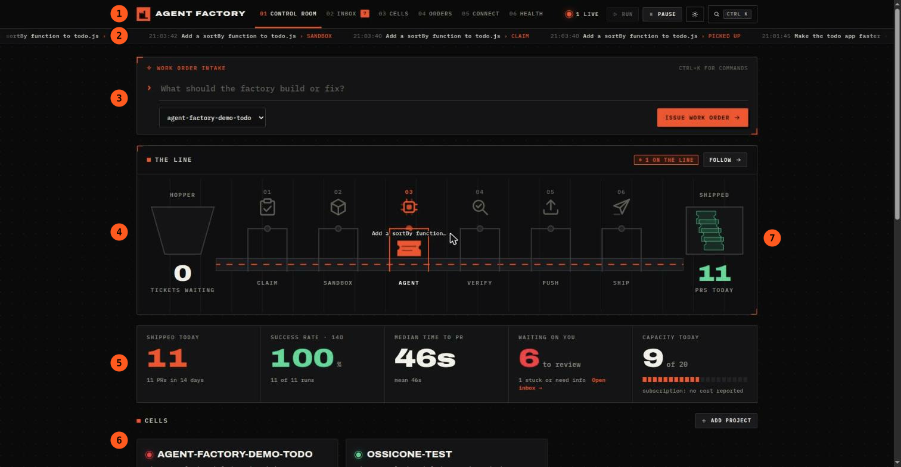
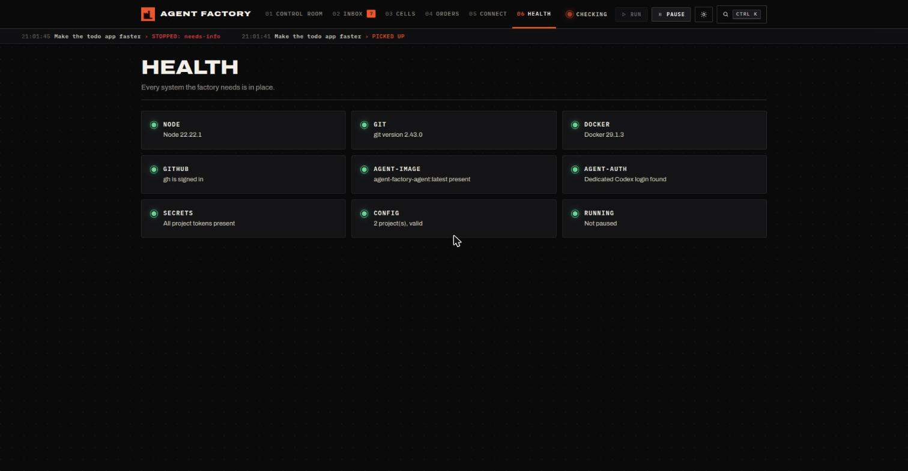
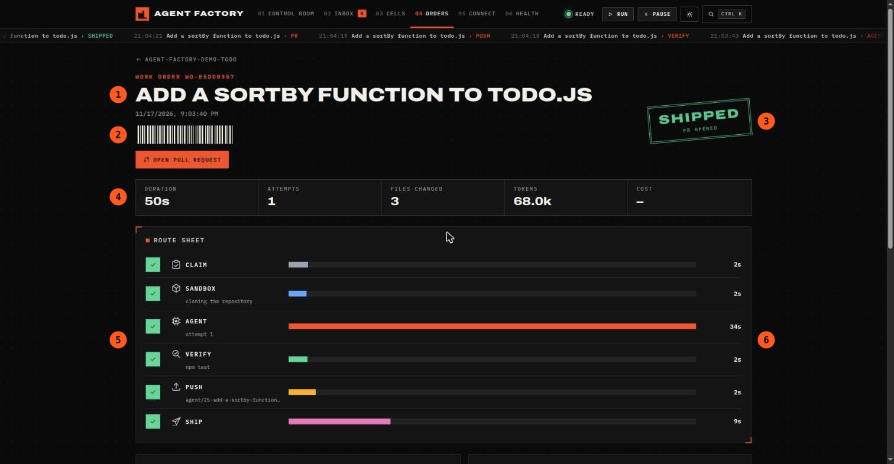
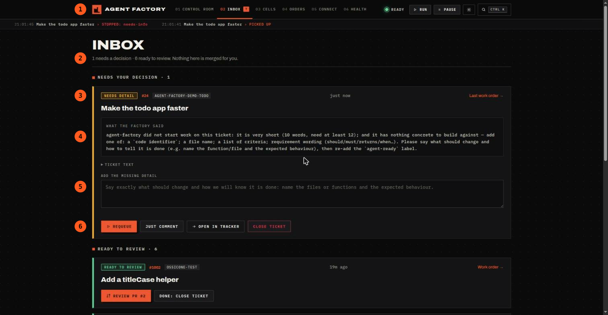
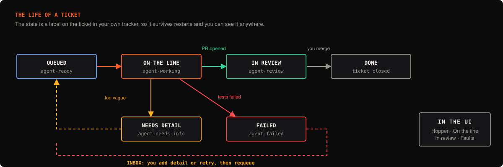
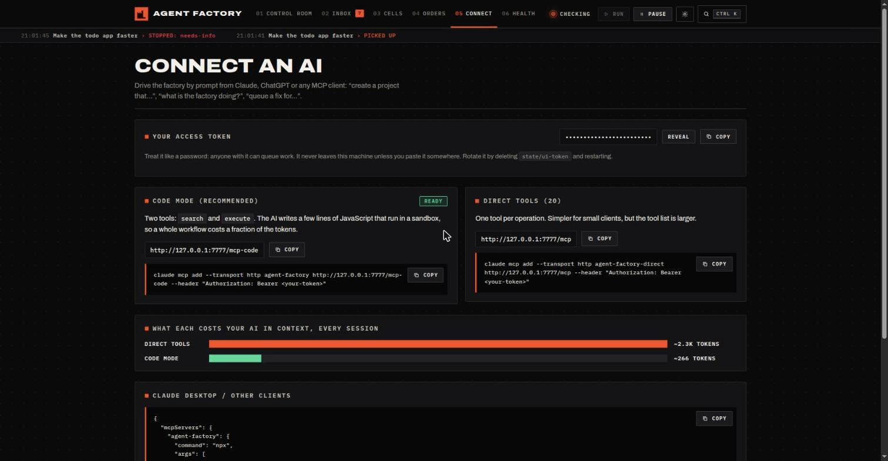
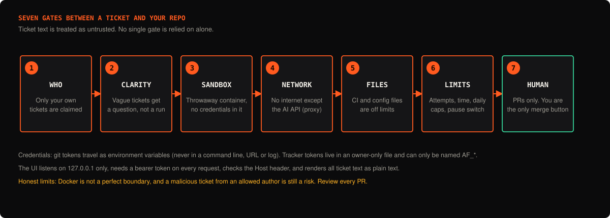

<div align="center">



# Agent Factory — the illustrated guide

**Write a ticket. Get a reviewed pull request. You stay in charge of the merge button.**

[Quick start](#2-install-and-first-run) · [Tour](#3-a-tour-of-the-control-room) · [First work order](#4-your-first-work-order) · [Connect your tools](#5-connect-your-own-tools) · [Inbox](#6-the-inbox) · [Drive it by prompt](#8-drive-it-by-prompt-mcp) · [Safety](#9-how-it-keeps-you-safe) · [Running it](#10-running-it-for-real) · [Is it production ready?](#11-is-it-production-ready)

</div>

---

## 1. What it does, in one picture


| You do | The factory does | You never lose |
|---|---|---|
| Describe a small, concrete change in your tracker, or in the web UI | Checks the ticket is specific, builds it in a throwaway Docker sandbox with Claude Code or Codex, runs *your* tests, opens a **draft** pull request, answers CI failures and review comments | The merge button. Nothing is ever merged for you, and every run is bounded and logged |

It works with the tools you already use: **tickets** in GitHub Issues, Ossicone, Jira or Linear; **code** on GitHub, GitLab, Bitbucket or any git server.

---

## 2. Install and first run

**You need** Node 22+, Docker and git, plus a Codex (ChatGPT) or Claude login. The GitHub CLI is only needed if you use GitHub. Full per-OS prerequisites are in [setup.md](setup.md).

```bash
git clone https://github.com/stevenmcsorley/agent-factory.git
cd agent-factory
npm install            # one small optional dependency (QuickJS) for MCP Code Mode
npm run init           # the setup wizard
npm start              # prints your private link
```

`npm run init` walks you through it and is safe to re-run:

```text
Agent Factory setup

1. Checking prerequisites
  ✓ Node 22.x   ✓ git   ✓ Docker   ✓ GitHub CLI signed in
  ✓ sandbox image ready
2. Choosing an agent            (codex = ChatGPT subscription, claude = Claude subscription or API key)
  A link and a one-time code appear: open it, sign in, enter the code.
3. Your first project           (owner/name, or skip and add one in the UI)
Done. Start the factory:  npm start
```

`npm start` prints a link like `http://127.0.0.1:7777/#token=…`. Open it. That token is your key to the UI; keep it private.

> **Tip:** `npm run doctor` re-checks everything and prints a fix for anything that is wrong. The **Health** page in the UI shows the same checks.

---

## 3. A tour of the control room



| | |
|---|---|
| **1** | **Header.** Navigation (the **Inbox** badge counts what is waiting on you), the line's status lamp, **Run** (check for work now), **Pause**, the light/dark switch, and the command palette (`Ctrl`/`⌘` + `K`). |
| **2** | **Ticker.** A live stream of what the line is doing, newest first. |
| **3** | **Work-order intake.** Type what you want built or fixed. A live check tells you if it is too short to act on; the agent handles the rest. |
| **4** | **The line.** Queued tickets wait in the **hopper**; each running job rides the belt through six stations. A station lights up and its icon animates while it is working: *claim* (a check draws itself), *sandbox* (the crate opens), *agent* (the chip pulses), *verify* (a magnifier scans), *push* (an arrow rises), *ship* (a plane takes off). |
| **5** | **Spec strip.** Shipped today, success rate, median time to PR, **waiting on you** (click it to open your inbox) and today's remaining capacity. |
| **6** | **Cells.** One per project, with a status lamp (green fine, orange working, red needs you), a 14-day history and queue tallies. |
| **7** | **Shipped chute.** Pull requests opened today. |

<details>
<summary><b>More screens</b>: command palette, health, light theme</summary>

| Command palette | Health |
|---|---|
|  |  |


</details>

---

## 4. Your first work order

1. **Describe it** in the intake box. Name the file or function and say how you will know it is done:
   > *Add an exported `slugify(text)` function in `slugify.js` that lowercases the text and replaces every run of non-alphanumeric characters with a single dash. Add tests and mention it in the README.*
2. **Watch the hint.** "Good to go" turns green, sometimes with a tip. Only tickets too short to act on are held back; if the agent finds a request genuinely open-ended it asks specific questions in your inbox instead of guessing.
3. **Issue the work order.** A ticket is created in *your* tracker, labelled `agent-ready`. The factory claims it on its next cycle (or press **Run** to go now).
4. **Watch the line.** The ticket slides out of the hopper and along the belt. The whole thing usually takes under a minute for a small change.
5. **Open the work order** to see exactly what happened:



| | |
|---|---|
| **1** | The work-order number and title. |
| **2** | A barcode derived from the order id (the same id used in the URL and the audit log). |
| **3** | The **verdict stamp**: *Shipped* (PR opened), *Rejected* (tests failed or a rule was broken) or *Held* (needs your input). |
| **4** | Duration, attempts, files changed, tokens and cost (cost shows `–` on a subscription). |
| **5** | The **route sheet**: one row per station with a bar sized to the time it took. Below it are the agent's own notes, the files it changed, and the test output. |
| **6** | Time spent at each station. |

6. **Review the pull request** (the orange button). Merge it, ask for changes by commenting on it, or close it. If you comment, or CI fails, the agent pushes a follow-up commit (up to three rounds, then it hands back to you).

---

## 5. Connect your own tools

Open **Cells → Add project**. You make two independent choices, so you can mix freely (for example *Jira tickets with a Bitbucket repo*):


| | |
|---|---|
| **1** | **Where your code lives**: GitHub, GitLab, Bitbucket, or any git remote. |
| **2** | Paste the access token, enter the repository, and press **Check access**. It tells you who you are connected as and the default branch *before* anything is saved. |
| **3** | **Where your tickets live**: GitHub Issues, Ossicone, Jira or Linear. **Test connection** lists your projects so you can pick one. |
| **4** | For Ossicone the wizard checks whether the server allows **sign-up** and links you to *Create an account*, *Sign in* and *Get an API token*. |

**Repository analysis.** As soon as access checks out, the wizard takes a quick read-only look at the code and shows a **Code health** card:

- **Ratings (A to E)** for size, tests, duplication, upkeep (huge files, TODO/FIXME) and committed secrets (it reports the file, never the key).
- **How changes will be verified**: the detected test command (npm, pnpm, yarn, pytest, go, cargo, make, or an app in a subfolder such as `cd engine && npm test`). It is editable, so fix it here if it guessed wrong.
- **Warnings**, such as "no way to run tests was found: pull requests will be UNVERIFIED".

The result is saved with the project, summarised for the agent on every run, and shown on the project's board with a **Re-analyze** button. **Health** warns about any project with no known test command. This is a fast, line-based scan in the spirit of SonarQube's dashboard, not a full static analyser.


**Which token, from where?**

| Service | What to create |
|---|---|
| GitHub | Nothing: it uses the `gh` CLI you are signed into (`gh auth login`) |
| GitLab | Access token with the `api` scope, Developer role or higher |
| Bitbucket Cloud | App password with repositories and pull requests read + write |
| Any git remote | An ssh URL (uses your ssh keys) or an https token |
| Ossicone | Settings → *AI Agent* → **Generate token** (read + write) |
| Jira Cloud | An API token from id.atlassian.com, plus your account email |
| Jira Data Center | A personal access token |
| Linear | A personal API key |

Tokens are checked against the real service first, then stored in an owner-only file (`state/secrets.env`), never in the config. Only tickets **you** created can queue work.

---

## 6. The inbox

Anything that needs a human lands in the **Inbox**, so nothing gets stuck silently.



| | |
|---|---|
| **1** | The nav badge counts everything waiting on you. |
| **2** | A one-line summary: how many need a decision, how many are ready to review. |
| **3** | The card header: the state (*Needs detail*, *Failed*, *Ready to review*), ticket number, project, age, and a link to the last work order. |
| **4** | **What the factory said**: the reason it stopped, in its own words. |
| **5** | **Add the missing detail.** The same live check runs as you type. |
| **6** | **Requeue** (puts it back on the line, with your detail added to the ticket), **Just comment**, **Open in tracker**, or **Close**. A still-vague ticket is refused with advice instead of bouncing again. |

For tickets that are *Ready to review*, the card has a button straight to the PR and a **Done: close ticket** button for after you merge.



### The board

Each cell has a board with the same four stages:


| | |
|---|---|
| **1** | The cell and its lamp. |
| **2** | Tabs: *Board*, *Pull requests*, *Work orders*, *New ticket* and *Log*. |
| **3** | **Hopper**: queued, waiting for the next cycle. |
| **4** | **On the line**: being worked on right now. |
| **5** | **In review**: a draft PR is waiting for you. |
| **6** | **Faults**: needs detail or failed (the striped header). |

---

## 7. Everyday recipes

| I want to… | Do this |
|---|---|
| Queue a change | Intake box on the control room, or **Cells → (project) → New ticket**, or just label an issue `agent-ready` in your tracker |
| Rescue a stuck ticket | **Inbox**, add the missing detail, **Requeue** |
| Stop everything right now | **Pause** in the header (or `touch state/STOP`) |
| Stop one project | **Cells → (project) → Pause** |
| See why something failed | Open its **work order**: the route sheet shows the station it stopped at, and the output shows why |
| Add another repo | **Cells → Add project** |
| Limit usage | `limits.maxRunsPerDay` (and `dailyBudgetUsd` for API keys) in `agent-factory.json` |
| Use it from my phone/laptop | See [Running it for real](#10-running-it-for-real): keep it on loopback and use a tunnel or reverse proxy with TLS |

---

## 8. Drive it by prompt (MCP)

You can run the whole factory from Claude (or any MCP client) in plain English.



```bash
claude mcp add --transport http agent-factory http://127.0.0.1:7777/mcp-code \
  --header "Authorization: Bearer <your-token>"
```

The **Connect** page shows this with your token filled in (masked on screen, real when copied). Then talk to it:

```text
You     What is the factory doing right now, and is anything waiting on me?
Claude  [inbox] 1 ticket needs detail ("Make the todo app faster") and 6 PRs are ready to review.
You     Queue a fix: add a search(list, query) function to todo.js that matches case-insensitively, with tests.
Claude  [create_ticket] Queued as #26. [activity] It is on the line, at the agent station.
You     Ticket 24 was too vague. Tell it to add an exported sortBy(list, key) function to todo.js, with tests.
Claude  [requeue_ticket] Requeued with your detail; the clarity check passed.
```

| Mode | Tools | Cost to your AI per session |
|---|---|---|
| **Code Mode** `/mcp-code` (recommended) | `search` + `execute` (your AI writes a few lines of JavaScript that run in a sandbox) | about 270 tokens |
| **Direct tools** `/mcp` | one tool per operation | about 2,000 tokens |

Vague requests are refused with advice, and the factory never merges.

---

## 9. How it keeps you safe



The most important rule is the last one: **a human is the only merge button.** The agent runs in a container with no credentials and no internet except its own AI provider's API (through an allowlisting proxy). Git credentials are only used by the factory *outside* the sandbox, after the agent has finished.

What it does **not** protect against: a malicious ticket from someone you have allowed to queue work, and a determined escape from Docker. Review every PR, and keep the list of allowed authors short.

---

## 10. Running it for real

**Keep it running (Linux).** The factory prints a ready-made systemd unit with the right paths:

```bash
node src/cli.mjs service      # follow the three commands in its header
```

**Check it is alive.** `GET /healthz` returns `{"ok":true}` without a token, for uptime monitors. `npm run doctor` gives a full report.

**What lives where.**

| Path | What it is | Back it up? |
|---|---|---|
| `agent-factory.json` | Your projects and limits (no secrets) | Yes |
| `state/secrets.env` | Tokens, owner-only (mode 600) | Yes, keep private |
| `state/runs.jsonl`, `state/projects/*` | Run history, logs, per-project state | Optional |
| `~/.agent-factory/codex` | The factory's own Codex login | Re-login is easy |

**Upgrade.** `git pull && npm install`, then restart. Your config and state are untouched.

**Using it from elsewhere.** The UI refuses to listen on anything but `127.0.0.1` unless you opt in. The safe way to reach it remotely is an authenticated tunnel or a TLS reverse proxy in front, with the UI token still required.

**Provider terms.** Driving an unattended agent from a consumer subscription (ChatGPT, Claude) may be restricted by that provider; OpenAI recommends API keys for CI-style automation. Check the current terms, and use `maxRunsPerDay` because subscription limits are shared with your normal use.

---

## 11. Is it production ready?

**Honest answer: ready for supervised use on a machine you control; not yet "set and forget".**

| ✅ Solid today | ⚠️ Not yet |
|---|---|
| The core loop is covered by 87 automated tests, and CI runs them (including a real Docker network test) on every push | **No long unattended soak** (days) has been run yet. Treat the first weeks as supervised |
| GitHub and Ossicone were run **end to end against real servers**: queue → build → PR → status written back → inbox actions | **Jira, Linear, GitLab and Bitbucket** were built from their API docs and tested against fakes, plus real calls proving bad credentials fail cleanly. No full real-account cycle yet |
| Sandbox, egress allowlist, protected files, caps, pause switch and crash recovery are all exercised | State is **JSON files** on one machine: single process, no high availability |
| Secrets are verified before saving, stored owner-only, and can never be read from arbitrary environment variables | **Linux** is the tested platform. macOS and Windows (WSL2) are untested |
| The UI is loopback-only with a token, Host check, strict CSP and no `innerHTML` | No built-in TLS, multi-user login or audit export; keep it behind your own access control |
| Every run records its phases, timing, tokens, the agent's notes and the test output | Non-Node projects are detected but only Node was tested end to end |

**Recommended rollout:** point it at one low-risk repository, keep the daily cap low, read every PR, and watch the **Faults** column for a couple of weeks before widening it.

---

## 12. Troubleshooting

| Symptom | Fix |
|---|---|
| "Run" does nothing | Open **Health**: a paused factory, a missing token or a stopped Docker blocks work |
| A ticket is never picked up | It must be created by *you* and carry `agent-ready` (or use the intake box). New issues can take a few seconds to appear in GitHub's lists; tickets created from the UI are found immediately |
| Ticket is waiting for info | Open the **Inbox**, read the agent's questions, answer them in one line each, **Requeue** |
| `Could not connect` in the wizard | The message comes straight from the service: usually a wrong token scope or URL |
| `docker: permission denied` | Add your user to the `docker` group and log in again |
| Health says the agent image is missing | `npm run build-image` |
| Health says there is no Codex login | Re-run `npm run init` in an interactive terminal |
| The UI asks for a token | `node src/cli.mjs token` prints the sign-in link |

---

## Glossary

| Word | Meaning |
|---|---|
| **Work order** | One run of the factory on one ticket (or one feedback round on a PR) |
| **Cell** | A project: a repository plus a ticket source and its queue |
| **Hopper** | The queue of tickets waiting to be picked up |
| **The line** | The six stations a job passes through |
| **Route sheet** | The per-station timing of a finished work order |
| **Inbox** | Everything that needs a human decision or review |
| **Needs info** | The agent (or the too-short check) wants an answer before building; answer it in the inbox |
