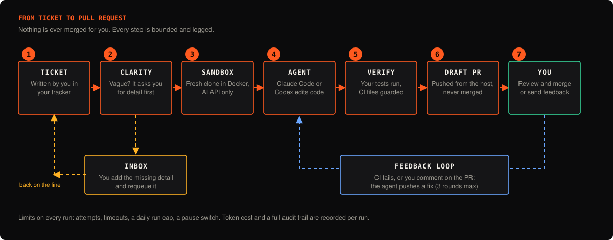
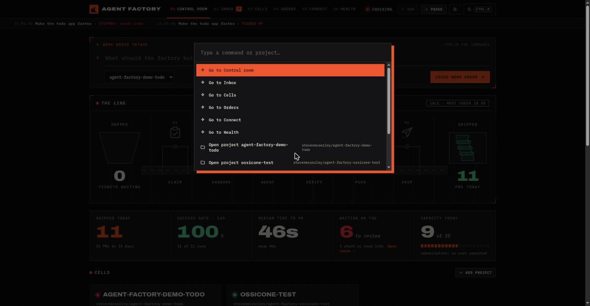
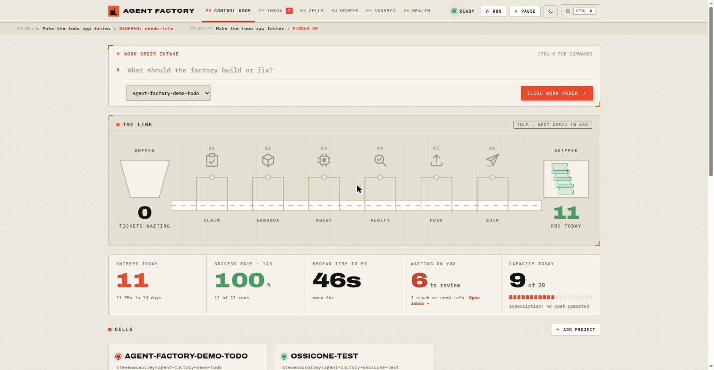
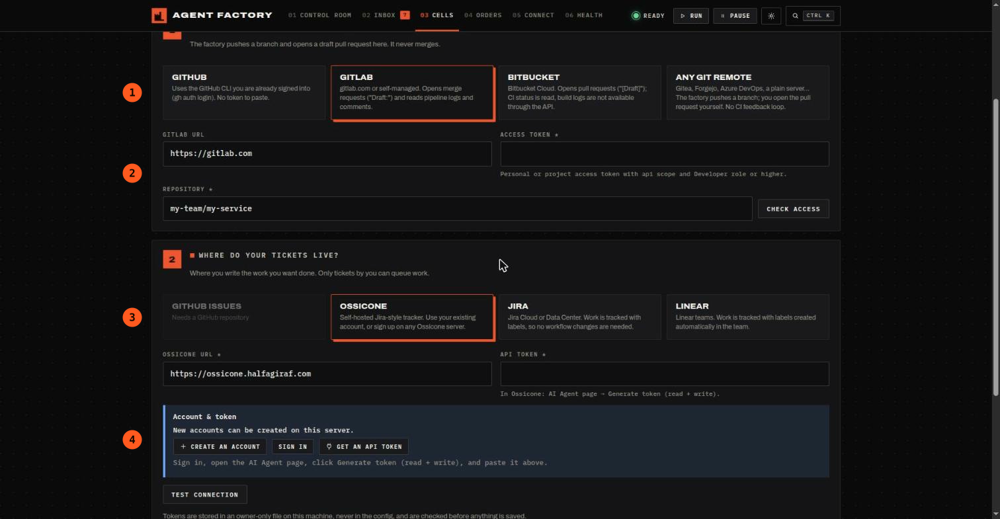
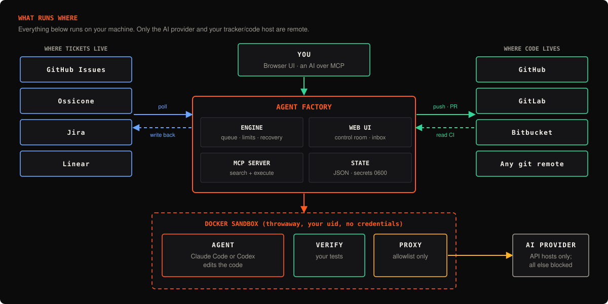
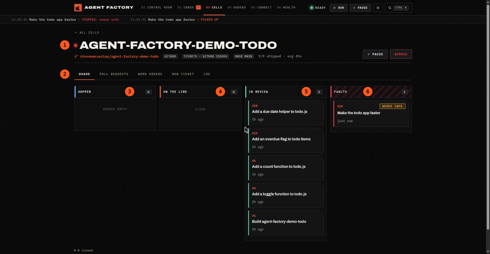

<div align="center">


# Agent Factory — the illustrated guide

**Write a ticket. Get a reviewed pull request. You stay in charge of the merge button.**

[Quick start](#2-install-and-first-run) · [Tour](#3-a-tour-of-the-control-room) · [First work order](#4-your-first-work-order) · [Connect your tools](#5-connect-your-own-tools) · [Inbox](#6-the-inbox) · [Drive it by prompt](#8-drive-it-by-prompt-mcp) · [Safety](#9-how-it-keeps-you-safe) · [Running it](#10-running-it-for-real) · [Is it production ready?](#11-is-it-production-ready)

</div>

---

## 1. What it does, in one picture



| You do | The factory does | You never lose |
|---|---|---|
| Describe a small, concrete change in your tracker, or in the web UI | Checks the ticket is specific, builds it in a throwaway Docker sandbox with Claude Code or Codex, runs *your* tests, opens a **draft** pull request, answers CI failures and review comments | The merge button. Nothing is ever merged for you, and every run is bounded and logged |

It works with the tools you already use: **tickets** in GitHub Issues, Ossicone, Jira or Linear; **code** on GitHub, GitLab, Bitbucket or any git server.

---

## 2. Install and first run

**You need** Node 22+, Docker and git, plus a Codex (ChatGPT) or Claude login. The GitHub CLI is only needed if you use GitHub. Full per-OS prerequisites are in [setup.md](setup.md).

```bash
git clone https://github.com/stevenmcsorley/agent-factory.git
cd agent-factory
npm install            # one small optional dependency (QuickJS) for MCP Code Mode
npm run init           # the setup wizard
npm start              # prints your private link
```

`npm run init` walks you through it and is safe to re-run:

```text
Agent Factory setup

1. Checking prerequisites
  ✓ Node 22.x   ✓ git   ✓ Docker   ✓ GitHub CLI signed in
  ✓ sandbox image ready
2. Choosing an agent            (codex = ChatGPT subscription, claude = Claude subscription or API key)
  A link and a one-time code appear: open it, sign in, enter the code.
3. Your first project           (owner/name, or skip and add one in the UI)
Done. Start the factory:  npm start
```

`npm start` prints a link like `http://127.0.0.1:7777/#token=…`. Open it. That token is your key to the UI; keep it private.

> **Tip:** `npm run doctor` re-checks everything and prints a fix for anything that is wrong. The **Health** page in the UI shows the same checks.

---

## 3. A tour of the control room


| | |
|---|---|
| **1** | **Header.** Navigation (the **Inbox** badge counts what is waiting on you), the line's status lamp, **Run** (check for work now), **Pause**, the light/dark switch, and the command palette (`Ctrl`/`⌘` + `K`). |
| **2** | **Ticker.** A live stream of what the line is doing, newest first. |
| **3** | **Work-order intake.** Type what you want built or fixed. A live check tells you if it is too short to act on; the agent handles the rest. |
| **4** | **The line.** Queued tickets wait in the **hopper**; each running job rides the belt through six stations. A station lights up and its icon animates while it is working: *claim* (a check draws itself), *sandbox* (the crate opens), *agent* (the chip pulses), *verify* (a magnifier scans), *push* (an arrow rises), *ship* (a plane takes off). |
| **5** | **Spec strip.** Shipped today, success rate, median time to PR, **waiting on you** (click it to open your inbox) and today's remaining capacity. |
| **6** | **Cells.** One per project, with a status lamp (green fine, orange working, red needs you), a 14-day history and queue tallies. |
| **7** | **Shipped chute.** Pull requests opened today. |

<details>
<summary><b>More screens</b>: command palette, health, light theme</summary>

| Command palette | Health |
|---|---|
|  |  |



</details>

---

**Other pages in the header**

| Page | What it is for |
|---|---|
| **Portfolio** | Every project from *brief → plan → build → ship* on one screen, with the next step for each and a "Needs you" list. Start here when you have several projects |
| **Library** | The reuse library: parts, repeated code, upgrades |
| **Cells** → a project | Tabs: *Board, Plan, Brief, Pull requests, Work orders, Code, Log* |

> **Seeing the old interface after an upgrade?** An open browser tab keeps the old code in memory. The factory now notices an update and shows an orange bar, *"The factory was updated. Reload to get the new interface."* Press **Reload now** (or Ctrl/⌘+Shift+R).

## 4. Your first work order

1. **Describe it** in the intake box. Name the file or function and say how you will know it is done:
   > *Add an exported `slugify(text)` function in `slugify.js` that lowercases the text and replaces every run of non-alphanumeric characters with a single dash. Add tests and mention it in the README.*
2. **Watch the hint.** "Good to go" turns green, sometimes with a tip. Only tickets too short to act on are held back; if the agent finds a request genuinely open-ended it asks specific questions in your inbox instead of guessing.
3. **Issue the work order.** A ticket is created in *your* tracker, labelled `agent-ready`. The factory claims it on its next cycle (or press **Run** to go now).
4. **Watch the line.** The ticket slides out of the hopper and along the belt. The whole thing usually takes under a minute for a small change.
5. **Open the work order** to see exactly what happened:


| | |
|---|---|
| **1** | The work-order number and title. |
| **2** | A barcode derived from the order id (the same id used in the URL and the audit log). |
| **3** | The **verdict stamp**: *Shipped* (PR opened), *Rejected* (tests failed or a rule was broken) or *Held* (needs your input). |
| **4** | Duration, attempts, files changed, tokens and cost (cost shows `–` on a subscription). |
| **5** | The **route sheet**: one row per station with a bar sized to the time it took. Below it are the agent's own notes, the files it changed, and the test output. |
| **6** | Time spent at each station. |

6. **Review the pull request** (the orange button). Merge it, ask for changes by commenting on it, or close it. If you comment, or CI fails, the agent pushes a follow-up commit (up to three rounds, then it hands back to you).

### Try the code checks in 10 minutes

1. Add a project (any repo you own) and open its **Code** tab. Read the folders, repeated code and untested files.
2. Press **Queue tests** on the biggest untested file. A ticket appears on the board.
3. Press **Run** (header) and watch the line. The agent writes tests, the verify step runs them, the quality gate checks the new lines, and a draft PR opens.
4. Open the work order: the **Quality gate on this change** card shows what was checked and the result.
5. Merge the PR if you like it, press **Re-analyze**, and watch "files covered" go up and the trend update.

### From a brief to a plan (the Project Pack)

A real project starts with more than one sentence: a PRD, research, designs, conventions. Each project has a **Brief** tab and a **Plan** tab for exactly that.

1. **Brief** (Brief tab, or the *Create new* form): *Goal*, *Users*, *In scope*, *Out of scope*, *Done means* and *Constraints*, plus **Stack and conventions** (what the agent must follow) and **Decisions** (what is already settled). A progress bar shows what is still missing.
2. **Source material**: upload files (Markdown, text, JSON, CSV, HTML, PDF, images; up to 5 MB each), add links (Figma, Notion, Google Docs, Jira) or paste text. Links are stored as references; the factory never fetches them.
3. **Plan**: press *Draft a plan from the brief*. The agent reads the brief, the sources and the existing code and proposes **epics and small tickets** with acceptance criteria, ordering and dependencies. You can retitle, reword and remove tickets before launch. Nothing touches your tracker until you launch.
4. **Launch**: tickets are created **as their dependencies are merged and closed**, so each builds on real code. The Plan tab tracks every ticket: not started → queued → building → in review → done.
5. **Every agent run now gets the context**: the brief, conventions and decisions, an index of the sources, and the text of the sources that match that ticket, also readable on disk under `.factory-context/` (never committed).
6. **Keep it with the code**: *Publish to the repo* opens a PR that adds a `.factory/` folder (brief, conventions, decisions, sources, plan), so it is versioned and readable by any teammate or agent.

The factory keeps the working copy (edits are instant); the repo copy is the published, reviewable mirror.

### Run it from Claude, Codex or any agent (CLI)

Everything above is available from the terminal against the running factory, with `--json` for machines. Give any agent `agent-factory agents-md` (the guide is in [docs/AGENT-GUIDE.md](AGENT-GUIDE.md)).

```bash
agent-factory portfolio                                   # every project: brief, plan, queue, PRs, quality
agent-factory brief my-app --goal="..." --scope=@scope.md --stack="..."
agent-factory source my-app ./PRD.md --kind=prd           # also a URL, or - for stdin
agent-factory plan my-app --wait                          # draft the plan; add --launch to approve it
agent-factory ops                                         # every operation (the same ones MCP exposes)
agent-factory op create_project --name=gym --brief='{"goal":"...","scope":"..."}' --plan=true
```

### The reuse library (build it once, reuse it everywhere)

When you run many projects, the same things get built again and again: a money formatter, a form field, an API client, an auth helper. The **Library** (top nav) is a catalog of those **parts**, kept in a git repo you own, so the factory can say *"you already have these"* before anything is built, and the agent copies a tested part instead of writing it again.

**Set it up** (once): *Library → Create a new library* (a private GitHub repo with the folder structure and a CI check) or connect an existing one. From the terminal: `agent-factory library create`.

**How parts get in**

| Way | How |
|---|---|
| The factory spots repeated code | *Library → Repeated code* lists the same component or logic found in several projects (renamed copies too). Press **Promote…**, name it, pick the files, and a pull request opens in the library repo (tick the box to skip the PR for your own library) |
| You choose a file | `agent-factory library promote <project> <file…> --name="Money Format" --summary="…" --tags=currency` |
| The agent proposes one | After building something generic, an agent can run the same command |

A part is a folder: `part.json` (name, kind, summary, tags, stack, **version**, API, usage, where it came from, changelog), `src/`, `test/` (matching tests are included) and a generated README. The library repo's CI validates every part and runs the tests of JavaScript parts.

**How parts get used**

1. A ticket is about to be built. The factory searches the catalog against the ticket, the brief and the project's language (name, tags, exported functions, summary; each match says why).
2. The agent is told *"Reusable parts you already have (prefer these…)"* with each part's API, and the files are placed under `.factory-context/library/<part>/`, each with a `factory-part: name@version` header.
3. The agent copies the part in, keeps the header, adapts imports and tests.
4. Afterwards the factory notices the reuse (header or exact copy), lists it on the PR under **Reused library parts**, and writes `.factory/parts.lock.json` into the same commit so the project records which version it has.
5. If the agent writes a *new file that is a rewrite of a part* instead, the quality gate flags it ("looks like part X, 100% similar"), sends it back once, and flags the PR if it stays.

**How parts are managed and shown**

* **Browse and test**: *Library → Parts* is searchable; each part shows its API, a usage example, every file with its source, **tests / no tests**, who uses which version, its origin and its changelog.
* **Use**: *Queue a ticket to add it* on any part (or `agent-factory library use <part> <project>`) creates a normal ticket.
* **Version**: edit a part in the library repo and bump `version` (or promote again, which bumps the minor version). *Library → Upgrades* lists projects on an older version, and one click opens an upgrade ticket in each (the agent gets the new files and the changelog).
* **Retire**: set `"deprecated": true` (and optionally `"replacedBy"`) in `part.json`. Deprecated parts are never suggested, and users show up under Upgrades.

* **Try it**: on a plain-JavaScript part, pick an exported function, type its arguments as a JSON array, and run it in a sandbox (no network, no files, 3 seconds) to see it work before you use it. From the terminal: `agent-factory library try <part> <function> --args='[…]'`.
* **Extract cleanly**: some code is too tangled into its project to promote as-is (it imports the app's own modules). On a repeated-code card press **Extract cleanly first**: the agent gets a ticket to move it into a standalone module with its own tests and no imports from the rest of the project. After you merge that PR, promote it.

Honest limits for now: matching is keyword-based (explained, but not semantic), the usage record covers uses made by the factory, *Try it* only runs plain JavaScript parts that do not import other modules, and the library's CI only runs tests for JavaScript parts.

### Alerts become tickets (webhooks)

Open a project's **Brief** tab → **Alerts become tickets**. It shows a private URL: point an error tracker, a monitor (Skylark, Vantage, Sentry…) or any script at it with a JSON `POST`:

```bash
curl -X POST 'http://127.0.0.1:7777/hook/<project>/<secret>' -H 'Content-Type: application/json' \
  -d '{"title":"Checkout returns 500 for an empty cart","body":"Seen 14 times. TypeError in cart.total()","source":"skylark","severity":"high","url":"https://…","key":"issue-1234"}'
```

Each alert is checked like any ticket, **de-duplicated by `key`** for 24 hours, **rate-limited** (30 an hour per project), and queued; the factory fixes it and you still review the PR. The secret in the URL is the only credential, so keep it private and use *Generate a new secret* if it leaks. The server listens on this machine only: to receive alerts from elsewhere, put an HTTPS tunnel or reverse proxy in front of it.

---

## 5. Connect your own tools

Open **Cells → Add project**. You make two independent choices, so you can mix freely (for example *Jira tickets with a Bitbucket repo*):



| | |
|---|---|
| **1** | **Where your code lives**: GitHub, GitLab, Bitbucket, or any git remote. |
| **2** | Paste the access token, enter the repository, and press **Check access**. It tells you who you are connected as and the default branch *before* anything is saved. |
| **3** | **Where your tickets live**: GitHub Issues, Ossicone, Jira or Linear. **Test connection** lists your projects so you can pick one. |
| **4** | For Ossicone the wizard checks whether the server allows **sign-up** and links you to *Create an account*, *Sign in* and *Get an API token*. |

**Repository analysis.** As soon as access checks out, the wizard takes a quick read-only look at the code and shows a **Code health** card: A to E ratings (size, tests, duplication, upkeep, committed secrets), the detected languages and package manager, and **how changes will be verified** (an editable test command such as `npm ci && npm test`, or `cd engine && npm test` for an app in a subfolder). If no way to run tests is found it warns that pull requests will be opened *unverified*. The result is saved with the project and summarised for the agent on every run. **Health** warns about any project with no way to verify.

### Inspect the code (the Code tab)

Every project has a **Code** tab: a plain-English explorer for the files, with no server and nothing to install. It has six sub-tabs:

| Sub-tab | What you get |
|---|---|
| **Overview** | The quality gate, key numbers, A–E ratings, a short **"What to look at first"** list (serious findings, the biggest file, the biggest untested file, the biggest repeat) each with a one-click button, folder sizes and a trend |
| **Findings** | Every problem with **the actual line of code**, a severity badge, a plain-English rule name, **why it matters and how to fix it**, and a link to that exact line on GitHub/GitLab/Bitbucket. Search it, filter by severity or kind, group by file, rule or severity. Per finding: **Queue fix** (ticket for the agent), **Ignore file**, **copy location**. Secrets are always shown masked (`••••••••`) |
| **Files** | The 40 largest source files with size bars, whether each has a test, and how many findings each has. Sort by size, findings or untested-first; filter to untested, with findings, or over 300 lines. **Queue tests** / **Queue split** per file |
| **Repeated code** | Blocks of 6 or more identical lines in two places, side by side (original and copy, with line ranges and links) and **Queue cleanup** |
| **Tests** | How many source files have a test (matched by name, or because a test imports them), and the biggest ones with none, with **Queue tests** |
| **Ignored** | What the analysis skipped, and your own ignore patterns (next section) |

Each button turns the finding into a normal ticket (for example "Remove duplicated code in src/b.js"), so the agent can tidy its own project. **Re-analyze** re-runs it any time and shows live progress. The Board tab keeps a compact summary with buttons that jump straight into the Findings and Overview views.

It is a fast, line-based scan: good for orientation, not a full static analyser. Add `quality-ignore` at the end of a line to skip a deliberate one (for example a fake key in an example).

**Try it on any folder from the terminal** (no config, nothing is changed):

```bash
npm run analyze -- .                       # this folder
npm run analyze -- ~/code/my-app           # any folder
npm run analyze -- https://github.com/owner/repo.git   # shallow, read-only clone
npm run analyze -- . --json                # the raw data
```

### Files the analysis ignores

Lock files and generated files are always long and never interesting, so they are **skipped completely**: not counted, not scanned for secrets, and not checked on the agent's changes. Built in (you do nothing): `package-lock.json`, `yarn.lock`, `pnpm-lock.yaml`, `Cargo.lock`, `poetry.lock`, `go.sum` and other `*.lock`, minified and bundled files (`*.min.js`), source maps, generated code and snapshots, build output (`dist/`, `build/`, `coverage/`, `.next/`, `vendor/`) and images or fonts. The Code tab's **Ignored from analysis** card shows how many were skipped and examples.

Add your own in any of three places (they combine):

| Where | How |
|---|---|
| The project's Code tab | Type patterns (one per line) and press **Save and re-analyze** |
| `agent-factory.json` | `"limits": { "analysis": { "ignore": ["*.sql", "docs/api/"] } }` for every project, or `"config": { "analysis": { "ignore": [...] } }` on one project |
| The repo itself | `.agent-factory.json`: `{ "analysis": { "ignore": ["generated/"] } }` (the agent cannot edit this file, so it cannot loosen its own gate) |

Pattern rules: `name.ext` matches anywhere (`*.sql`, `fixtures`), `dir/` matches a folder anywhere (`generated/`), `a/b/c` or `/a` is from the repository root (`docs/api/*.md`, `/legacy`), `*` and `?` stay inside one folder level, `**` crosses folders. No `..`, no `!`. Set `"ignoreDefaults": false` (in the same `analysis` block) to switch the built-in list off. From the terminal: `npm run analyze -- . --ignore=src/gen/,*.sql` and `--no-default-ignore`.

### The same gate checks the agent's own pull request

Before a PR is opened, only the lines the agent *added or changed* are checked ("clean as you code"; old problems are not blamed on the change). If the gate fails, the agent is told exactly what to fix and gets another attempt. A leftover secret stops the PR entirely (nothing is pushed); other findings are shown on the PR and on the work-order page as *flagged*. Tune it in `agent-factory.json`:

```json
{ "limits": { "qualityGate": { "maxNewVulnerabilities": 0, "maxNewBugs": 0, "maxNewSmells": null, "block": ["secrets"] } } }
```

(`"qualityGate": false` switches it off.) In a real test, a ticket asked the agent to commit a literal AWS-style key: the gate rejected the first attempt, the agent switched to reading it from an environment variable, and the PR opened with "Quality gate: passed".



**Which token, from where?**

| Service | What to create |
|---|---|
| GitHub | Nothing: it uses the `gh` CLI you are signed into (`gh auth login`) |
| GitLab | Access token with the `api` scope, Developer role or higher |
| Bitbucket Cloud | App password with repositories and pull requests read + write |
| Any git remote | An ssh URL (uses your ssh keys) or an https token |
| Ossicone | Settings → *AI Agent* → **Generate token** (read + write) |
| Jira Cloud | An API token from id.atlassian.com, plus your account email |
| Jira Data Center | A personal access token |
| Linear | A personal API key |

Tokens are checked against the real service first, then stored in an owner-only file (`state/secrets.env`), never in the config. Only tickets **you** created can queue work.

---

## 6. The inbox

Anything that needs a human lands in the **Inbox**, so nothing gets stuck silently.


| | |
|---|---|
| **1** | The nav badge counts everything waiting on you. |
| **2** | A one-line summary: how many need a decision, how many are ready to review. |
| **3** | The card header: the state (*Needs detail*, *Failed*, *Ready to review*), ticket number, project, age, and a link to the last work order. |
| **4** | **What the factory said**: the reason it stopped, in its own words. |
| **5** | **Add the missing detail.** The same live check runs as you type. |
| **6** | **Requeue** (puts it back on the line, with your detail added to the ticket), **Just comment**, **Open in tracker**, or **Close**. A still-vague ticket is refused with advice instead of bouncing again. |

For tickets that are *Ready to review*, the card has a button straight to the PR and a **Done: close ticket** button for after you merge.


### The board

Each cell has a board with the same four stages:



| | |
|---|---|
| **1** | The cell and its lamp. |
| **2** | Tabs: *Board*, *Pull requests*, *Work orders*, *New ticket* and *Log*. |
| **3** | **Hopper**: queued, waiting for the next cycle. |
| **4** | **On the line**: being worked on right now. |
| **5** | **In review**: a draft PR is waiting for you. |
| **6** | **Faults**: needs detail or failed (the striped header). |

---

## 7. Everyday recipes

| I want to… | Do this |
|---|---|
| Queue a change | Intake box on the control room, or **Cells → (project) → New ticket**, or just label an issue `agent-ready` in your tracker |
| Rescue a stuck ticket | **Inbox**, add the missing detail, **Requeue** |
| Stop everything right now | **Pause** in the header (or `touch state/STOP`) |
| Stop one project | **Cells → (project) → Pause** |
| See why something failed | Open its **work order**: the route sheet shows the station it stopped at, and the output shows why |
| Add another repo | **Cells → Add project** |
| Limit usage | `limits.maxRunsPerDay` (and `dailyBudgetUsd` for API keys) in `agent-factory.json` |
| Use it from my phone/laptop | See [Running it for real](#10-running-it-for-real): keep it on loopback and use a tunnel or reverse proxy with TLS |

---

## 8. Drive it by prompt (MCP)

You can run the whole factory from Claude (or any MCP client) in plain English.


```bash
claude mcp add --transport http agent-factory http://127.0.0.1:7777/mcp-code \
  --header "Authorization: Bearer <your-token>"
```

The **Connect** page shows this with your token filled in (masked on screen, real when copied). Then talk to it:

```text
You     What is the factory doing right now, and is anything waiting on me?
Claude  [inbox] 1 ticket needs detail ("Make the todo app faster") and 6 PRs are ready to review.
You     Queue a fix: add a search(list, query) function to todo.js that matches case-insensitively, with tests.
Claude  [create_ticket] Queued as #26. [activity] It is on the line, at the agent station.
You     Ticket 24 was too vague. Tell it to add an exported sortBy(list, key) function to todo.js, with tests.
Claude  [requeue_ticket] Requeued with your detail; the clarity check passed.
```

| Mode | Tools | Cost to your AI per session |
|---|---|---|
| **Code Mode** `/mcp-code` (recommended) | `search` + `execute` (your AI writes a few lines of JavaScript that run in a sandbox) | about 270 tokens |
| **Direct tools** `/mcp` | one tool per operation | about 2,000 tokens |

Vague requests are refused with advice, and the factory never merges.

---

## 9. How it keeps you safe


The most important rule is the last one: **a human is the only merge button.** The agent runs in a container with no credentials and no internet except its own AI provider's API (through an allowlisting proxy). Git credentials are only used by the factory *outside* the sandbox, after the agent has finished.

The agent can also write inside the checkout's `.git`, so before the factory runs any git command on your machine it rebuilds the repository config from scratch, deletes hooks and other executable extension points, and runs git with hooks, fsmonitor and the `ext::` transport disabled. A planted hook or config setting never runs.

What it does **not** protect against: a malicious ticket from someone you have allowed to queue work, and a determined escape from Docker. Review every PR, and keep the list of allowed authors short.

---

## 10. Running it for real

**Keep it running (Linux).** The factory prints a ready-made systemd unit with the right paths:

```bash
node src/cli.mjs service      # follow the three commands in its header
```

**Check it is alive.** `GET /healthz` returns `{"ok":true}` without a token, for uptime monitors. `npm run doctor` gives a full report.

**What lives where.**

| Path | What it is | Back it up? |
|---|---|---|
| `agent-factory.json` | Your projects and limits (no secrets) | Yes |
| `state/secrets.env` | Tokens, owner-only (mode 600) | Yes, keep private |
| `state/runs.jsonl`, `state/projects/*` | Run history, logs, per-project state | Optional |
| `~/.agent-factory/codex` | The factory's own Codex login | Re-login is easy |

**Upgrade.** `git pull && npm install`, then restart. Your config and state are untouched.

**Using it from elsewhere.** The UI refuses to listen on anything but `127.0.0.1` unless you opt in. The safe way to reach it remotely is an authenticated tunnel or a TLS reverse proxy in front, with the UI token still required.

**Provider terms.** Driving an unattended agent from a consumer subscription (ChatGPT, Claude) may be restricted by that provider; OpenAI recommends API keys for CI-style automation. Check the current terms, and use `maxRunsPerDay` because subscription limits are shared with your normal use.

---

## 11. Is it production ready?

**Honest answer: ready for supervised use on a machine you control; not yet "set and forget".**

| ✅ Solid today | ⚠️ Not yet |
|---|---|
| The core loop is covered by 87 automated tests, and CI runs them (including a real Docker network test) on every push | **No long unattended soak** (days) has been run yet. Treat the first weeks as supervised |
| GitHub and Ossicone were run **end to end against real servers**: queue → build → PR → status written back → inbox actions | **Jira, Linear, GitLab and Bitbucket** were built from their API docs and tested against fakes, plus real calls proving bad credentials fail cleanly. No full real-account cycle yet |
| Sandbox, egress allowlist, protected files, caps, pause switch and crash recovery are all exercised | State is **JSON files** on one machine: single process, no high availability |
| Secrets are verified before saving, stored owner-only, and can never be read from arbitrary environment variables | **Linux** is the tested platform. macOS and Windows (WSL2) are untested |
| The UI is loopback-only with a token, Host check, strict CSP and no `innerHTML` | No built-in TLS, multi-user login or audit export; keep it behind your own access control |
| Every run records its phases, timing, tokens, the agent's notes and the test output | Non-Node projects are detected but only Node was tested end to end |

**Recommended rollout:** point it at one low-risk repository, keep the daily cap low, read every PR, and watch the **Faults** column for a couple of weeks before widening it.

---

## 12. Troubleshooting

| Symptom | Fix |
|---|---|
| "Run" does nothing | Open **Health**: a paused factory, a missing token or a stopped Docker blocks work |
| A ticket is never picked up | It must be created by *you* and carry `agent-ready` (or use the intake box). New issues can take a few seconds to appear in GitHub's lists; tickets created from the UI are found immediately |
| Ticket is waiting for info | Open the **Inbox**, read the agent's questions, answer them in one line each, **Requeue** |
| `Could not connect` in the wizard | The message comes straight from the service: usually a wrong token scope or URL |
| `docker: permission denied` | Add your user to the `docker` group and log in again |
| Health says the agent image is missing | `npm run build-image` |
| Health says there is no Codex login | Re-run `npm run init` in an interactive terminal |
| The UI asks for a token | `node src/cli.mjs token` prints the sign-in link |

---

## Glossary

| Word | Meaning |
|---|---|
| **Work order** | One run of the factory on one ticket (or one feedback round on a PR) |
| **Cell** | A project: a repository plus a ticket source and its queue |
| **Hopper** | The queue of tickets waiting to be picked up |
| **The line** | The six stations a job passes through |
| **Route sheet** | The per-station timing of a finished work order |
| **Inbox** | Everything that needs a human decision or review |
| **Part** | A reusable piece of code (component, hook, utility, service, schema) kept in the library with its API, tests and version |
| **Library** | The git repo of parts shared by all projects; the factory suggests its parts before each build |
| **Webhook** | A private URL per project that turns an incoming alert into a ticket |
| **Candidate** | Code repeated across projects that should probably become a part |
| **Needs info** | The agent (or the too-short check) wants an answer before building; answer it in the inbox |
